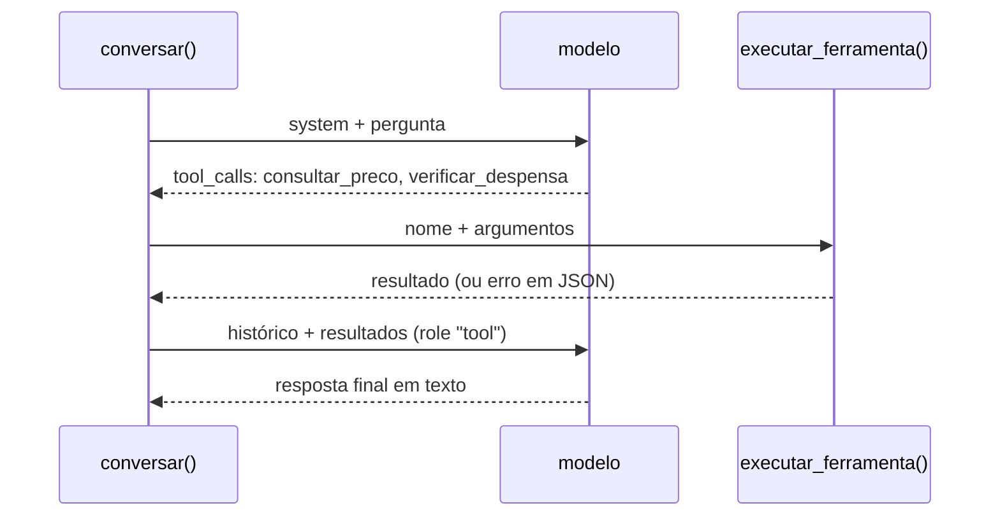
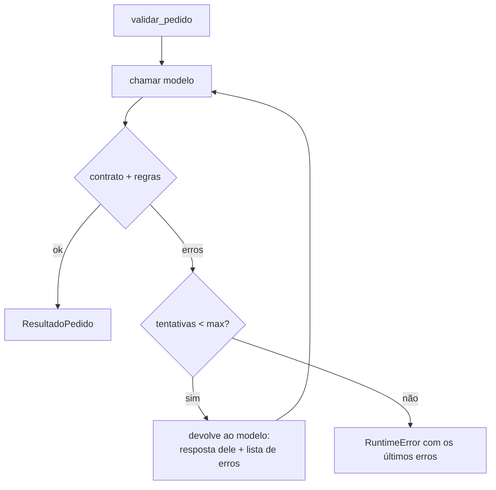

# LLM com contrato — do JSON solto ao roteamento por enum

Apresentação dos níveis **básico** (01–03) e **intermediário** (04–06) da trilha [`AI_use_cases`](../README.md).
Versão interativa (slides, demos e cupom de garantias): [`basico_e_intermediario.html`](basico_e_intermediario.html).

> **Sobre os exemplos.** Saídas marcadas como **real** vêm da API (gravadas em [`respostas_gravadas/`](../respostas_gravadas/README.md))
> ou da execução dos notebooks. As marcadas como **construído** são respostas no formato que o modelo devolveria, escritas à
> mão para demonstrar um caso. Nenhum exemplo construído é apresentado como saída de modelo.

---

## 1. O caso

Um **assistente de lista de compras**: o usuário diz o prato, o modelo devolve os ingredientes.

Parece simples, e é por isso que serve: cada coisa que dá errado aqui dá errado em qualquer aplicação com LLM.

```
  usuário ──► "pizza margherita para 2"
                      │
                      ▼
               ┌─────────────┐        o que pode dar errado
               │     LLM     │ ──►    • formato (JSON quebrado, texto em volta)
               └─────────────┘        • tipos ("250 grams" como texto)
                      │               • vocabulário ("cups" em vez de "g")
                      ▼               • bom senso (3 kg de sal)
               lista de compras       • escopo ("qual a capital da França?")
```

---

## 2. A trilha: cada notebook fecha uma brecha do anterior

```mermaid
flowchart LR
    N1["01 chamada e JSON"] -->|"quantidade é texto"| N2["02 saída estruturada"]
    N2 -->|"unidade aceita qualquer texto"| N3["03 enums e guardrails"]
    N3 -->|"valores absurdos passam;<br/>o modelo não sabe preços"| N4["04 ferramentas com funções"]
    N4 -->|"ninguém confere a lista final"| N5["05 regras e retry"]
    N5 -->|"todo pedido vira 'gere uma lista'"| N6["06 roteamento por enum"]
    N6 -->|"permissões, contexto, custo"| AV["avançado 07–10"]
```



| Nível | Notebooks | Modelo |
|---|---|---|
| Básico | 01 → 03 | API real, código direto |
| Intermediário | 04 → 06 | API real + funções simples |

---

## 3. Notebook 01 — chamada e JSON

O cliente lê chave e endpoint do `.env`, no mesmo molde do exemplo original:

```python
load_dotenv()
api_key = os.getenv("openai")
openai_base_url = os.getenv("openai_base_url")
ai_client = OpenAI(api_key=api_key, base_url=openai_base_url)
```

O formato é pedido **no prompt**:

```text
Answer in JSON format: [{"ingredients": "...", "amount": "..."}]
```

Resposta **real** (gpt-4o-mini, gravada): 484 caracteres, 9 itens.

```text
All-purpose flour: 250 grams
Active dry yeast: 5 grams
Salt: 5 grams
type(primeiro['amount']).__name__: str
```

---

## 4. Notebook 01 — o que quebra

| Situação | Resultado |
|---|---|
| dobrar a receita: `primeiro['amount'] * 2` (**real**) | `'250 grams250 grams'`: string repetida, sem erro |
| texto antes do JSON (**construído**) | `JSONDecodeError: Expecting value: line 1 column 1 (char 0)` |
| chave com outro nome (**construído**) | `KeyError: 'ingredients'` |

O pior dos três é o primeiro: **não dá erro**. O resultado errado segue adiante.

➡️ Falta um **contrato**: quais campos existem e de que tipo.

---

## 5. Notebook 02 — o contrato

```python
class Ingrediente(BaseModel):
    model_config = ConfigDict(extra="forbid")
    nome: str
    quantidade: float = Field(gt=0, description="Quantidade numérica, sem unidade")
    unidade: str = Field(description="Unidade métrica: g, kg, ml, l ou un")

class ListaDeCompras(BaseModel):
    model_config = ConfigDict(extra="forbid")
    prato: str
    porcoes: int = Field(gt=0)
    ingredientes: list[Ingrediente]
```

A classe gera o **JSON Schema**, que vai para o modelo, e **valida** a resposta que volta.

```text
quantidade: {'description': 'Quantidade numérica, sem unidade', 'exclusiveMinimum': 0, 'title': 'Quantidade', 'type': 'number'}
```

---

## 6. Notebook 02 — três jeitos de pedir o formato

| Jeito | Como | Funciona em |
|---|---|---|
| 2.1 schema no prompt + validação local | `prompt_com_schema(...)` + `model_validate_json` | qualquer endpoint compatível |
| 2.2 saída estruturada nativa | `client.chat.completions.parse(response_format=ListaDeCompras)` | endpoints que suportam |
| 2.3 pydantic-ai | `Agent(modelo, output_type=ListaDeCompras)` | idem 2.1, menos código |

**Pegadinha (testada):** dentro do Jupyter, `agente.run_sync(...)` dá
`RuntimeError: This event loop is already running`. Use `await agente.run(...)`.

---

## 7. Notebook 02 — o contrato trabalhando

A resposta **real** do 01 é recusada já no primeiro nível (é uma lista solta, não um objeto):

```text
erros: 1
primeiro: Input should be an object
('nome',): Field required
('quantidade',): Field required
('unidade',): Field required
('ingredients',): Extra inputs are not permitted
('amount',): Extra inputs are not permitted
```

Com uma resposta no formato novo (**construído**), dobrar a receita funciona:

```text
farinha de trigo: 500 g
fermento biológico seco: 10 g
água: 300 ml
```

---

## 8. Notebook 02 — o que quebra

1. **`description` é pedido, não regra.** `unidade: str` aceita `['cups', 'tablespoon']` (**construído**).
2. **Texto em volta do JSON** continua quebrando o caminho 2.1 (`json_invalid`). Recortar da primeira `{` à última `}`
   falha com prosa que tem chaves e transforma uma lista solta no primeiro item, sem erro. A saída é um **tipo de borda**:
   `TypeAdapter(Annotated[Json[Modelo], BeforeValidator(extrair_json)])`, com `extrair_json` decodificando
   (`raw_decode`) em vez de recortar. Texto entra, objeto validado sai; a aplicação não toca em texto.

➡️ O contrato garante **forma**. Falta fechar o **vocabulário**.

---

## 9. Notebook 03 — enums para o vocabulário

```python
class Unidade(StrEnum):
    G = "g"; KG = "kg"; ML = "ml"; L = "l"; UN = "un"

class Categoria(StrEnum):
    HORTIFRUTI = "hortifruti"; LATICINIOS = "laticinios"; CARNES = "carnes"
    MERCEARIA = "mercearia"; PADARIA = "padaria"
```

No schema, o enum vira **lista fechada** que o modelo enxerga:

```text
Unidade no schema: {'enum': ['g', 'kg', 'ml', 'l', 'un'], 'title': 'Unidade', 'type': 'string'}
('unidade',): Input should be 'g', 'kg', 'ml', 'l' or 'un'
```

Ganho prático: organizar a lista por seção do mercado, na ordem declarada.

```text
[hortifruti] manjericão fresco (1 un), tomate italiano (4 un)
[laticinios] muçarela de búfala (150 g)
[mercearia] farinha de trigo (250 g), azeite (15 ml)
```

---

## 10. Notebook 03 — guardrail de escopo

O modelo é **obrigado** a declarar o tipo do pedido; o código trata cada tipo.

```python
class TipoPedido(StrEnum):
    RECEITA = "receita"
    FORA_DO_ESCOPO = "fora_do_escopo"

class RespostaAssistente(BaseModel):
    tipo: TipoPedido
    lista: ListaDeCompras | None = None
    motivo: str | None = None

    @model_validator(mode="after")
    def tipo_combina_com_conteudo(self): ...   # receita exige lista; fora do escopo exige motivo
```

```text
receita sem lista: Value error, tipo 'receita' exige 'lista'
fora do escopo sem motivo: Value error, tipo 'fora_do_escopo' exige 'motivo' e não aceita 'lista'
tipo inventado: Input should be 'receita' or 'fora_do_escopo'
```

---

## 11. Notebook 03 — o que quebra

| Pegadinha | Demonstração | Saída |
|---|---|---|
| enum compara texto exato | `Unidade("G")` | `ValueError: 'G' is not a valid Unidade` |
| | correção: `BeforeValidator` que faz `strip().lower()` | `" G"` vira `Unidade.G` |
| `match` sem `case _` | enum ganha `SUBSTITUICAO` | `rotular(SUBSTITUICAO): None` (sem erro) |
| enum ≠ bom senso | 3 kg de sal, 40 muçarelas, farinha em laticínios (**construído**) | tudo **válido** |

➡️ Decidir se um valor faz sentido exige **regras** e **dados** que o modelo não tem. Isso é código.

---

## 12. Fechamento do básico

| Notebook | Garantiu | Ficou de fora |
|---|---|---|
| 01 | chamar a API e ler JSON | formato e tipos |
| 02 | forma: campos e tipos (Pydantic) | vocabulário dos campos |
| 03 | vocabulário (enum) e escopo (guardrail) | bom senso dos valores, dados externos |

---

## 13. Notebook 04 — ferramentas com funções

O modelo não sabe o preço do tomate nem o que tem na despensa. Ferramentas são **funções Python comuns** que ele pode
**pedir**; quem executa é o seu código.

```python
class Ferramenta(StrEnum):
    CONSULTAR_PRECO = "consultar_preco"
    VERIFICAR_DESPENSA = "verificar_despensa"

FERRAMENTAS = {Ferramenta.CONSULTAR_PRECO: (ArgsIngrediente, consultar_preco), ...}
TOOLS = [openai.pydantic_function_tool(args, name=f.value, description=...) for f, (args, _) in FERRAMENTAS.items()]
```

---

## 14. Notebook 04 — o guardrail na execução

```python
def executar_ferramenta(nome: str, argumentos_json: str) -> str:
    try:
        ferramenta = Ferramenta(nome)                 # 1. a ferramenta existe?
    except ValueError:
        return json.dumps({"erro": f"ferramenta desconhecida: {nome}"})
    modelo_args, funcao = FERRAMENTAS[ferramenta]
    try:
        args = modelo_args.model_validate_json(argumentos_json)   # 2. os argumentos batem?
    except ValidationError as ex:
        return json.dumps({"erro": "argumentos inválidos", ...})
    return json.dumps(funcao(**args.model_dump()))   # 3. só então executa
```

Erro **não levanta exceção**: vira resultado da ferramenta e volta ao modelo, que pode corrigir.

```text
inexistente: {"erro": "ferramenta desconhecida: apagar_arquivos"}
args errados: {"erro": "argumentos inválidos", "detalhes": [{"type": "extra_forbidden", "loc": ["ingrediente"], ...
```

---

## 15. Notebook 04 — o laço



- `chamar_modelo` entra como **parâmetro**: API real ou roteiro construído, o laço é o mesmo.
- `ConfiguracaoChamada` é `@dataclass(frozen=True)` com `max_rodadas`: um modelo que pede ferramentas para sempre
  para em `RuntimeError: sem resposta final em 2 rodadas`.

---

## 16. Notebook 04 — o que quebra

| Pegadinha | Saída |
|---|---|
| `float` não é dinheiro | `0.10 + 0.20: 0.30000000000000004` |
| `pydantic_function_tool` gera `"strict": true` | endpoints compatíveis podem ignorar ou recusar; a validação local continua necessária |
| resultado de ferramenta volta para o prompt | dado de fonte externa é **entrada não confiável** |

➡️ A lista final ainda pode ter 3 kg de sal: ninguém confere **regras**.

---

## 17. Notebook 05 — regras como funções

```python
LIMITE_POR_PESSOA = {Unidade.G: 400, Unidade.KG: 0.4, Unidade.ML: 300, Unidade.L: 0.3, Unidade.UN: 4}

def regra_quantidade_por_pessoa(lista) -> list[str]: ...   # lista de problemas; vazia = ok
def regra_sem_duplicados(lista) -> list[str]: ...

REGRAS = [regra_quantidade_por_pessoa, regra_sem_duplicados]
```

```text
- sal: 3 kg passa do limite de 0.8 kg para 2 porções
- muçarela de búfala: 40 un passa do limite de 8 un para 2 porções
- ingrediente repetido: sal
```

Regras que dependem só do **pedido** vão **antes** da chamada:

```text
ValueError: porções devem estar entre 1 e 20, recebido 50
```

---

## 18. Notebook 05 — retry com feedback



Roteiro **construído** (a primeira resposta exagera, a segunda corrige):

```text
resultado.tentativas: 2
resultado.erros_por_tentativa: [['farinha de trigo: 2 kg passa do limite de 0.8 kg para 2 porções'], []]
```

---

## 19. Notebook 05 — o que quebra

| Pegadinha | Demonstração |
|---|---|
| cada tentativa reenvia a conversa inteira | caracteres enviados por tentativa: `[1162, 1533, 1904]` |
| regras ficam **fora** do contrato | `ListaDeCompras.model_validate_json(...)` sozinho aceita os 2 kg de farinha |
| regras sem contexto | o limite é fixo; orçamento, despensa e preços não entram |
| retry não conserta pedido ruim | problema determinístico só gasta tentativas |

---

## 20. Notebook 06 — roteamento por enum

O modelo **classifica** (saída pequena e validada); o código **decide** (tabela de rotas).

```python
class Intencao(StrEnum):
    RECEITA = "receita"; PRECO = "preco"
    SUBSTITUICAO = "substituicao"; FORA_DO_ESCOPO = "fora_do_escopo"

ROTAS = {Intencao.RECEITA: responder_receita, Intencao.PRECO: responder_preco, ...}
assert not set(Intencao) - ROTAS.keys()          # teste de cobertura

FERRAMENTAS_POR_ROTA = {Intencao.PRECO: frozenset({Ferramenta.CONSULTAR_PRECO}), ...}   # menor privilégio
LIMIAR_CONFIANCA = 0.7                           # abaixo disso: revisão humana
```

Classificações **construídas**:

```text
'Quanto está o quilo da muçarela?' -> consultar preço de 'muçarela'
'Me indica um filme' -> recusar com educação: só ajudo com compras de mercado
'Tem algo pra janta?' -> revisão humana (confiança 0.40 < 0.7)
```

---

## 21. Notebook 06 — o que quebra

| Pegadinha | Saída |
|---|---|
| confiança é o modelo falando de si | "bomba de chocolate" classificada fora do escopo com 0.95 passa pelo limiar |
| rota faltando sem teste de cobertura | `KeyError: <IntencaoV2.CARDAPIO_DA_SEMANA: 'cardapio_da_semana'>` |
| o **valor** do enum é formato gravado | `ValueError: 'preco' is not a valid IntencaoRenomeada` |
| valor desconhecido derruba a classificação | `Input should be 'receita', 'preco', 'substituicao' or 'fora_do_escopo'` |

Regra prática: o **nome** do membro (`PRECO`) pode mudar; o **valor** (`"preco"`) é contrato com o mundo de fora.

---

## 22. Fechamento do intermediário

| Notebook | Garantiu | Falta, e onde |
|---|---|---|
| 04 | dados reais via ferramentas, guardrail na execução | dinheiro em `float`, limite de custo → 09 |
| 05 | regras de negócio + retry com feedback | regras fora do contrato, sem contexto → 07 |
| 06 | intenção → rota, ferramentas por rota, cobertura | permissões, enum aberto → 08 |

---

## 23. O que levar

```
            o modelo PROPÕE                         o código DECIDE
  ┌───────────────────────────────┐      ┌──────────────────────────────────┐
  │ JSON no formato do schema     │ ───► │ Pydantic: forma e tipos          │
  │ valores do enum               │      │ Enum: vocabulário fechado        │
  │ pedido de ferramenta          │      │ guardrail: existe? args batem?   │
  │ intenção + confiança          │      │ regras, limites, rota, permissão │
  └───────────────────────────────┘      └──────────────────────────────────┘
          prompt informa                       validação garante
```

1. **Prompt informa, código garante.** `description`, instrução e schema são pedidos ao modelo.
2. **Erro silencioso é o pior erro.** `'250 grams250 grams'` e `rotular(...) -> None` não levantam nada.
3. **Erro de validação é feedback.** Ele volta ao modelo (ferramenta, retry) em vez de derrubar o programa.
4. **Toda tabela por enum precisa de teste de cobertura.** Rotas, ferramentas, permissões.
5. **O valor do enum é contrato externo.** Renomeie o membro, nunca o valor.

Próximo: [avançado 07–10](../03_avancado/07_contrato_e_contexto.ipynb), com contrato que conhece o contexto,
permissões, custo e um pipeline testável.
