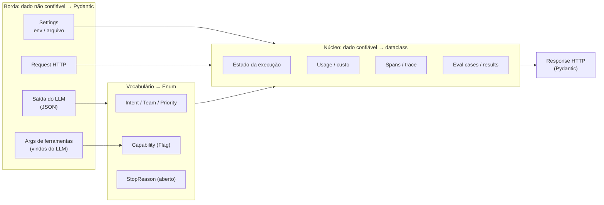

# AI Use Cases — Pydantic, Enum e Dataclass em aplicações com LLM

> **Versão original**, anterior à trilha. A trilha atual (básico → intermediário → avançado) está em
> [`../README.md`](../README.md). Estes notebooks ficam como referência: são mais densos e cobrem alguns tópicos que a
> trilha não repete (streaming parcial, FastAPI).

Casos práticos de como as três ferramentas aparecem em agentes e pipelines com LLMs.
Todos os notebooks rodam **offline**: `fake_llm.py` fornece um `ScriptedLLM` que devolve respostas roteirizadas
(inclusive respostas **erradas**, para exercitar validação e retry). O código de chamada real aos SDKs aparece em
células de referência.

> Cada notebook tem uma seção **⚠️ Pegadinhas, efeitos colaterais e caveats** perto do fim, com demonstrações offline.

## Mapa

| # | notebook | ferramenta | o que mostra |
|---|---|---|---|
| 1 | [`01_pydantic_structured_output`](01_pydantic_structured_output.ipynb) | Pydantic | saída estruturada de agentes: schema como prompt, `messages.parse`/`responses.parse`, parser robusto + retry com `ValidationError` como feedback, validators contra alucinação, evidência literal, streaming parcial |
| 2 | [`02_pydantic_tool_calling`](02_pydantic_tool_calling.ipynb) | Pydantic | registro de ferramentas, specs Anthropic/OpenAI (`strict`), loop de agente, guardrails com contexto, erros devolvidos ao modelo, ferramentas a partir da assinatura, schema publicado × validação local |
| 3 | [`03_enum_routing_and_guardrails`](03_enum_routing_and_guardrails.ipynb) | Enum | classificação de intenção com rótulos ricos, roteamento por tabela + limiar de confiança, multi-rótulo com `Flag`, seleção de modelo por tier, permissões de ferramentas com `Flag`, `stop_reason` como enum aberto |
| 4 | [`04_dataclass_agent_runtime`](04_dataclass_agent_runtime.ipynb) | dataclass | `LLMConfig` imutável, memória com orçamento de tokens, contabilidade de uso/custo, tracing com spans, harness de avaliação |
| 5 | [`05_agent_pipeline_end_to_end`](05_agent_pipeline_end_to_end.ipynb) | as três | triagem de tickets: settings → entrada → LLM estruturado → regras com Enum → estado em dataclass → resposta, inclusive atrás de FastAPI |

## A divisão de responsabilidades



```
  Pergunta-guia para escolher:

  O dado vem de fora (usuário, arquivo, env, LLM, outra API)?  ── sim ──►  Pydantic
        │ não
        ▼
  É um conjunto fechado de opções/rótulos?                     ── sim ──►  Enum (Flag se combináveis)
        │ não
        ▼
  É estado/registro interno, criado pelo seu código?           ── sim ──►  dataclass (frozen/slots conforme o caso)
```

## Lições que os notebooks demonstram (com execução real)

1. **Schema garante forma, não verdade.** Um JSON perfeitamente válido pode ter números inventados; validators semânticos
   (somas, datas, evidência literal) pegam o que a decodificação restrita não pega.
2. **`ValidationError` é o melhor feedback para o modelo**: campo + problema + valor recebido, prontos para o retry.
3. **Schema publicado ≠ validação local.** Publique schemas simples para o LLM (ex.: `Decimal` → `number` via `WithJsonSchema`);
   valide com rigor localmente.
4. **Guardrails moram no código**, alimentados por contexto de execução (limites, permissões via `Flag`), nunca só no prompt.
5. **Enums do provedor devem ser abertos** (`_missing_` → `UNKNOWN`): valores novos não podem derrubar o agente.
6. **Streaming parcial**: o modo parcial do Pydantic não entra em campos de `BaseModel` — use um espelho `TypedDict` durante o stream.
7. **Falhar barato**: validar a entrada antes de chamar o LLM economiza tokens e latência.

## Como trocar o LLM simulado por um real

`ScriptedLLM` é chamado como `llm(messages, **kwargs) -> LLMResponse(text, tool_calls, stop_reason, input_tokens, output_tokens)`.
Basta escrever um adaptador com a mesma assinatura usando o SDK do provedor. Exemplo com o SDK da Anthropic (structured output):

```python
from anthropic import Anthropic
client = Anthropic()

response = client.messages.parse(
    model="claude-opus-5-5",
    max_tokens=1024,
    messages=[{"role": "user", "content": "..."}],
    output_format=MeuModeloPydantic,     # o SDK traduz para output_config.format
)
obj = response.parsed_output
```

Documentação: <https://platform.claude.com/docs/en/build-with-claude/structured-outputs>
