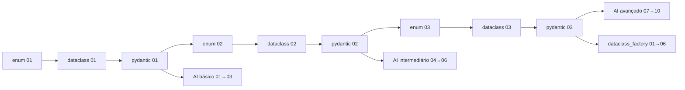

# Data & Classes — Pydantic, Dataclass e Enum

Estudo completo das três ferramentas que modelam dados em Python, com foco em **arquivos de configuração**,
**camadas de dados de APIs e aplicações** e **casos de uso com LLMs**.

Cada módulo tem uma teoria (`.md`) e três notebooks (básico → intermediário → avançado). O módulo `dataclass_factory`
junta as três ferramentas em torno de **configuração dirigida por arquivos e fábricas**. Todos os notebooks foram
**executados** e estão salvos com as saídas.

```
data-and-classes/
├── README.md                     ← você está aqui
├── requirements.txt
├── pydantic/
│   ├── pydantic.md               teoria: fronteira de confiança, pydantic-core, lax/strict, settings, DTOs de API
│   ├── 01_pydantic_basico.ipynb
│   ├── 02_pydantic_intermediario.ipynb
│   ├── 03_pydantic_avancado.ipynb
│   └── complete/                 curso "Pydantic V2: Essentials" (F. Baptiste) traduzido, revisado e com projetos resolvidos
├── dataclass/
│   ├── dataclass.md              teoria: geração de código, field(), hash/frozen/slots, arquitetura de bordas
│   ├── 01_dataclass_basico.ipynb
│   ├── 02_dataclass_intermediario.ipynb
│   └── 03_dataclass_avancado.ipynb
├── enum/
│   ├── enum.md                   teoria: EnumType, família (Str/Int/Flag), contratos abertos × fechados
│   ├── 01_enum_basico.ipynb
│   ├── 02_enum_intermediario.ipynb
│   └── 03_enum_avancado.ipynb
├── dataclass_factory/
│   ├── dataclass_factory.md      teoria: formatos, fábricas, camadas, políticas, modelos a partir de especificação
│   ├── 01_formatos_de_configuracao.ipynb      YAML, TOML, JSON, INI, .env: tipos e pegadinhas
│   ├── 02_factory_pattern.ipynb               registro, Enum, __init_subclass__, união discriminada, abstract factory
│   ├── 03_configuracao_tipada.ipynb           dataclass × TypeAdapter × BaseSettings, camadas, enums, segredos
│   ├── 04_politicas_e_presets.ipynb           ConfigDict/@dataclass vindos de arquivo, validados (ModelPolicy)
│   ├── 05_modelos_a_partir_de_especificacao.ipynb   meta-modelo → Enum, create_model, make_dataclass, código gerado
│   ├── 06_caso_completo.ipynb                 pipeline de exportação guiado por configuração
│   ├── configs/                  arquivos de exemplo usados pelos notebooks
│   ├── validadores.py            funções referenciadas por nome nas especificações
│   └── generated/                código gerado pelo notebook 05
└── AI_use_cases/                 trilha com LLM, um assistente de lista de compras do começo ao fim
    ├── README.md                 mapa da trilha, como configurar o .env, ganchos entre níveis
    ├── .env.example              modelo do .env (chave e endpoint)
    ├── 01_basico/                API real: chamada e JSON, saída estruturada, enums e guardrails
    ├── 02_intermediario/         API real + funções simples: ferramentas, regras e retry, roteamento por enum
    ├── 03_avancado/              modelo simulado (formato OpenAI): contexto, permissões, runtime, pipeline testável
    ├── respostas_gravadas/       respostas reais da API usadas nos notebooks
    └── casos_originais/          versão anterior dos casos de LLM (mais densa, sem progressão)
```

## Ordem sugerida



Começar pelo Enum (o mais simples) e terminar no Pydantic (o mais completo) em cada nível faz cada notebook reaproveitar
o anterior: o Pydantic intermediário usa Enum, o dataclass avançado faz a ponte com Pydantic, e os casos de LLM usam tudo.
Cada nível da trilha de LLM pede só o que o nível correspondente dos módulos já cobriu.

## As três em uma tabela

| | `Enum` | `dataclass` | `pydantic.BaseModel` |
|---|---|---|---|
| o que modela | conjunto **fechado** de valores | registro de dados | **contrato** de dados |
| valida em runtime | só "pertence ao conjunto" | ❌ | ✅ (tipos + restrições + regras) |
| converte tipos | `Enum(valor)` | ❌ | ✅ (lax) / ❌ (strict) |
| serializa JSON | `.value` / `StrEnum` | manual (`asdict` + encoder) | ✅ `model_dump_json` |
| JSON Schema | via Pydantic | via `TypeAdapter` | ✅ |
| custo por objeto | zero (singletons) | mínimo | baixo (Rust), maior que dataclass |
| dependência | stdlib | stdlib | `pip install pydantic` |
| lugar natural | vocabulário do domínio | núcleo / estado interno | bordas: API, config, LLM |

## Arquitetura recomendada

```
            BORDA (não confiável)                       NÚCLEO (confiável)
  ┌─────────────────────────────────┐        ┌───────────────────────────────────┐
  │ Pydantic                        │        │ dataclasses (frozen / slots)      │
  │  • BaseSettings (env, YAML...)  │ ─────► │  • entidades, value objects       │
  │  • Request / Response DTOs      │        │  • estado, eventos internos       │
  │  • saída de LLM, args de tools  │ ◄───── │  • resultados de serviços         │
  └─────────────────────────────────┘        └───────────────────────────────────┘
                    ▲                                         ▲
                    └──────────── Enum (vocabulário) ─────────┘
                       status, tipos, rótulos, permissões (Flag)
```

## Como rodar

```bash
cd data-and-classes
python -m venv .venv && source .venv/bin/activate     # ou conda/uv
pip install -r requirements.txt
jupyter lab
```

Requer **Python ≥ 3.12** (usa sintaxe de genéricos PEP 695 no dataclass avançado e em `AI_use_cases/casos_originais/01`;
o resto roda em 3.11).
Testado com Python 3.13, Pydantic 2.13, pydantic-settings 2.16, FastAPI 0.162, openai 3.49 e pydantic-ai 2.68.

As células que chamam a API (trilha `AI_use_cases`, básico e intermediário) têm a tag `skip-execution`: o `nbconvert`
as pula, então o laço acima roda sem `.env`.

Para reexecutar tudo de uma vez (verificação):

```bash
for nb in */*.ipynb */*/*.ipynb; do jupyter nbconvert --to notebook --execute --inplace "$nb" || echo "FALHOU: $nb"; done
```

## Notas sobre o material de partida

Os notebooks originais de estudo (pydantic, dataclasses, enum) serviram de base. Pontos corrigidos/aprofundados aqui:

* **enum** — a seção "Vantagens/Desvantagens" falava de `Flag`, não de `Enum`; agora estão separados.
  O exemplo `BLACK = 12` num `Flag` não cria uma cor nova: é um alias de `YELLOW | BLUE` (demonstrado em `enum/02`).
  `case _: print(f"... {Color} ...")` imprimia a classe, não o valor recebido.
* **dataclass** — o exemplo que dizia usar `object.__setattr__` em classe `frozen` estava com `frozen=False`;
  `frozen` é **raso** (listas internas continuam mutáveis); `slots=True` e `cached_property` não combinam.
* **pydantic** — `EmailStr` exige o extra `pydantic[email]`; "Vantagem 4" estava duplicada; `model_construct` **não** é
  atalho de performance na v2 (medido em `pydantic/03`).
