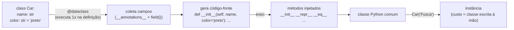
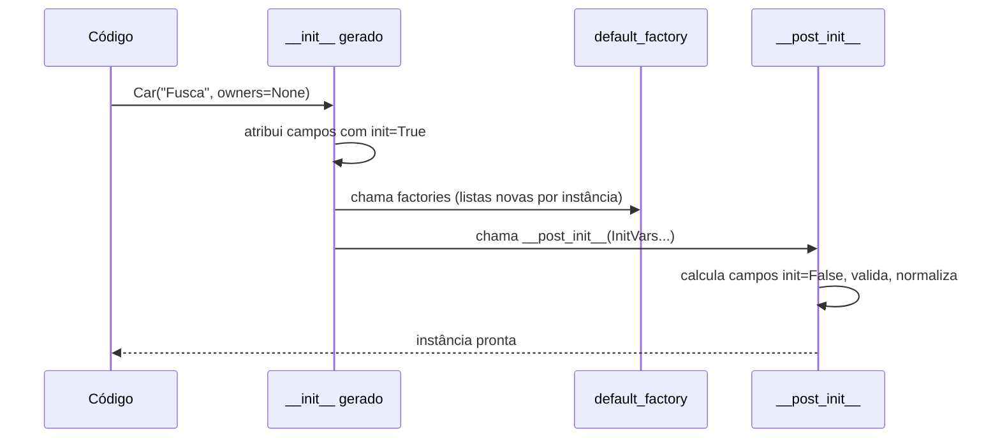

# Dataclass — Teoria

> Versão de referência: **Python 3.13** (`dataclasses` da biblioteca padrão; recursos marcados com a versão mínima quando > 3.7).
> Notebooks deste módulo: [`01_dataclass_basico`](01_dataclass_basico.ipynb) · [`02_dataclass_intermediario`](02_dataclass_intermediario.ipynb) · [`03_dataclass_avancado`](03_dataclass_avancado.ipynb)

> Cada notebook termina com uma seção **⚠️ Pegadinhas, efeitos colaterais e caveats** (as já vistas no corpo + novas, com demonstração).

---

## 1. O que é

`dataclasses` é um módulo da biblioteca padrão (desde o Python 3.7, PEP 557) com um decorador, `@dataclass`, que
**gera código repetitivo** para classes cujo papel principal é guardar dados: `__init__`, `__repr__`, `__eq__` e,
opcionalmente, `__lt__`/`__le__`/..., `__hash__`, `__match_args__`, `__slots__` e proteção contra escrita.

É importante ser preciso sobre o que ela **não** é: dataclass **não valida** e **não converte** nada.
As anotações de tipo servem para o gerador saber quais são os campos (e para o seu editor/mypy), mas
`Product(price="caro")` é aceito sem reclamação.

## 2. Que problema resolve

Classe de dados escrita à mão é cheia de *boilerplate* — e boilerplate é onde nascem bugs bobos:
`__eq__` que esqueceu um campo, `__repr__` desatualizado, `__init__` com default mutável compartilhado.

```
  ANTES (classe comum)                          DEPOIS (@dataclass)
  ─────────────────────────────                 ──────────────────────────
  class Car:                                    @dataclass
      def __init__(self, name, color):          class Car:
          self.name = name                          name: str
          self.color = color                        color: str
      def __repr__(self): ...
      def __eq__(self, other): ...              # __init__, __repr__, __eq__
      # 15+ linhas, fáceis de dessincronizar    # gerados e sempre coerentes
```

## 3. Como funciona por dentro

O decorador roda **uma vez**, quando a classe é definida. Ele:

1. lê `__annotations__` da classe (a ordem de declaração vira a ordem dos parâmetros);
2. para cada anotação cria um objeto `Field` (usando o `field(...)` se você declarou um);
3. **gera o código-fonte** dos métodos como texto e o compila com `exec`;
4. injeta os métodos na classe (ou, com `slots=True`, **cria uma classe nova** com `__slots__`).



Consequência prática: **o custo em tempo de execução é o mesmo de uma classe escrita à mão**.
Não há metaclasse, proxy ou validação escondida — por isso dataclass é a opção mais rápida entre as "classes de dados".

## 4. Parâmetros do decorador

| parâmetro | padrão | efeito | versão |
|---|---|---|---|
| `init` | `True` | gera `__init__` | 3.7 |
| `repr` | `True` | gera `__repr__` | 3.7 |
| `eq` | `True` | gera `__eq__` (compara tuplas de campos, só entre a **mesma classe**) | 3.7 |
| `order` | `False` | gera `<`, `<=`, `>`, `>=` (ordem dos campos) | 3.7 |
| `unsafe_hash` | `False` | força `__hash__` mesmo sendo mutável (perigoso) | 3.7 |
| `frozen` | `False` | atribuição levanta `FrozenInstanceError` | 3.7 |
| `match_args` | `True` | gera `__match_args__` para `match/case` posicional | 3.10 |
| `kw_only` | `False` | todos os campos só por nome | 3.10 |
| `slots` | `False` | cria a classe com `__slots__` (menos memória, acesso mais rápido, sem atributos dinâmicos) | 3.10 |
| `weakref_slot` | `False` | adiciona `__weakref__` quando `slots=True` | 3.11 |

### Regras de `__hash__` (fonte de muita confusão)

| `eq` | `frozen` | `unsafe_hash` | resultado |
|---|---|---|---|
| `True` | `False` | `False` | `__hash__ = None` → **não pode** ir em `set`/chave de `dict` |
| `True` | `True` | `False` | hash gerado a partir dos campos ✅ |
| `False` | — | `False` | herda `object.__hash__` (identidade) |
| — | — | `True` | hash gerado mesmo mutável ⚠️ (mutar depois de inserir num `set` corrompe o `set`) |

## 5. `field()` — controle por campo

| argumento | uso |
|---|---|
| `default` | valor padrão imutável |
| `default_factory` | função que gera o default (**obrigatório para `list`, `dict`, `set`**) |
| `init=False` | campo fora do construtor (calculado em `__post_init__`) |
| `repr=False` | oculta no `repr` (segredos, listas grandes) |
| `compare=False` | ignora em `__eq__`/ordem (timestamps, caches) |
| `hash=None/True/False` | inclui/exclui do hash (padrão segue `compare`) |
| `kw_only=True` | só esse campo é nomeado |
| `metadata={...}` | dicionário livre, lido por bibliotecas/seu código (unidade, validação, coluna do banco) |

Complementos do módulo: `__post_init__`, `InitVar` (parâmetro do `__init__` que não vira campo), `KW_ONLY` (sentinela),
`ClassVar` (atributo de classe, ignorado), `fields()`, `asdict()`, `astuple()`, `replace()`, `is_dataclass()`, `make_dataclass()`.

## 6. Ciclo de vida de uma instância



`__post_init__` é **o único gancho** para validar ou derivar dados. Em classes `frozen`, para atribuir nele
é preciso usar `object.__setattr__(self, "campo", valor)`.

## 7. Dataclass para arquivos de configuração

Dataclass funciona para configuração quando **você controla a fonte** e quer zero dependências:

```
config.toml ──tomllib.load──► dict ──(sua função de conversão)──► AppConfig(frozen=True)
```

| prós | contras |
|---|---|
| stdlib (`tomllib` + `dataclasses`), zero dependência | nada valida tipos: `port = "5432"` entra como `str` |
| `frozen=True` dá imutabilidade | dicionários aninhados **não** viram dataclasses sozinhos — `AppConfig(**d)` deixa `database` como `dict` |
| rápido, simples de testar | env vars, `.env`, precedência de fontes: tudo manual |
| bom para configs internas de bibliotecas/ferramentas | mensagens de erro ruins (ou nenhuma) |

Na prática: para **aplicações** (serviços, APIs, jobs em produção) prefira `pydantic-settings`. Para configuração de
**biblioteca** ou ferramenta de linha de comando simples, dataclass + `tomllib` + `__post_init__` é suficiente.
O notebook intermediário mostra as duas coisas: o loader manual e onde ele começa a doer.

## 8. Dataclass na camada de dados de APIs e aplicações

A divisão de responsabilidades que escala bem é a **arquitetura de bordas** (hexagonal / ports & adapters):

```
            BORDA (não confiável)                     NÚCLEO (confiável)
  ┌───────────────────────────────┐       ┌──────────────────────────────────────┐
  │ Pydantic                      │       │ dataclasses                          │
  │  • request/response DTOs      │──map─►│  • entidades e value objects         │
  │  • settings                   │       │  • resultados de serviços            │
  │  • payloads de fila / LLM     │◄─map──│  • eventos de domínio internos       │
  └───────────────────────────────┘       │  • estado de algoritmos / pipelines  │
                                          └──────────────────────────────────────┘
          valida 1x na entrada                 sem custo de validação repetida
```

Por que não usar Pydantic em tudo? Porque dentro do núcleo os dados **já foram validados**; revalidar a cada objeto
criado (em loops, em pipelines de dados, em simulações) é custo sem benefício. E por que não dataclass em tudo?
Porque na borda você **precisa** de validação, conversão, mensagens de erro e JSON Schema.

Pontes úteis:
* `pydantic.TypeAdapter(MinhaDataclass)` valida dados **para dentro de uma dataclass stdlib** (sem mudar a classe).
* `pydantic.dataclasses.dataclass` é uma dataclass com validação (meio-termo).
* FastAPI aceita dataclasses stdlib como corpo/resposta (usa Pydantic por baixo).

## 9. Performance e memória

| estrutura | criação | memória por instância* | mutável | valida |
|---|---|---|---|---|
| `tuple` / `namedtuple` | muito rápida | menor | não | não |
| `@dataclass(slots=True)` | muito rápida | pequena | sim (ou `frozen`) | não |
| `@dataclass` | muito rápida | maior (tem `__dict__`) | sim | não |
| `pydantic.BaseModel` | rápida (Rust) | maior | sim (ou `frozen`) | **sim** |
| `dict` | muito rápida | grande | sim | não |

\* `slots=True` remove o `__dict__` por instância: em milhões de objetos a economia é de dezenas a centenas de MB
(medido no notebook avançado).

## 10. Armadilhas comuns

1. **Default mutável** — `tags: list = []` levanta `ValueError` na definição. Use `field(default_factory=list)`.
   (O erro só pega `list`, `dict` e `set`; outros objetos mutáveis passam e são compartilhados entre instâncias.)
2. **Tipos não são validados** — `Car(name=123)` funciona. Valide em `__post_init__` ou use Pydantic.
3. **Herança com defaults** — campo sem default depois de campo com default na classe-pai → `TypeError`. Solução: `kw_only=True`.
4. **`frozen` é raso** — `frozen=True` impede `obj.lista = ...`, mas não `obj.lista.append(...)`. Use `tuple`/`frozenset` para imutabilidade real.
5. **`eq=True` sem `frozen` remove o hash** — a instância não entra em `set`.
6. **`slots=True` e `cached_property`** — não funcionam juntos (não há `__dict__` onde guardar o cache).
7. **`asdict()` faz deep copy recursivo** — é lento em estruturas grandes e converte dataclasses aninhadas em dicts (às vezes não é o que você quer).
8. **`__eq__` só compara instâncias da mesma classe exata** — `Point(1, 2) == SubPoint(1, 2)` é `False`: o método gerado devolve `NotImplemented` e o Python cai na comparação por identidade.

## 11. Quando usar e quando não usar

**Use** para: entidades e value objects de domínio, DTOs internos entre camadas, resultados de funções com vários campos,
estado de algoritmos, eventos internos, configuração de biblioteca, testes (fixtures legíveis), grandes volumes de objetos (`slots=True`).

**Não use** (sozinha) para: dados de fonte externa (HTTP, arquivo do usuário, LLM), configuração de aplicação com env vars,
qualquer lugar onde um tipo errado precise virar erro claro — aí é Pydantic na borda.

## 12. Roteiro de estudo

| Nível | Notebook | Você sai sabendo |
|---|---|---|
| Básico | `01_dataclass_basico.ipynb` | o que é gerado, defaults, `default_factory`, `field()`, `__post_init__`, `asdict`/`replace`, `order` |
| Intermediário | `02_dataclass_intermediario.ipynb` | `frozen`/hash, `slots`, `kw_only`/`KW_ONLY`, `InitVar`, herança, `ClassVar`, `metadata`, `match/case`, config TOML, JSON |
| Avançado | `03_dataclass_avancado.ipynb` | loader recursivo com type hints (mini-Pydantic), validação por metadata, `make_dataclass`, genéricos, `dataclass_transform`, benchmark de memória/tempo, ponte com Pydantic, arquitetura de bordas |

## Referências

* Documentação oficial: <https://docs.python.org/3/library/dataclasses.html>
* PEP 557 (dataclasses), PEP 681 (`dataclass_transform`)
* `tomllib`: <https://docs.python.org/3/library/tomllib.html>
