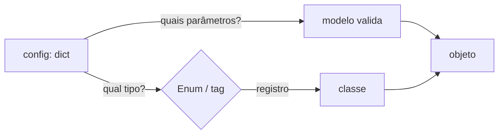
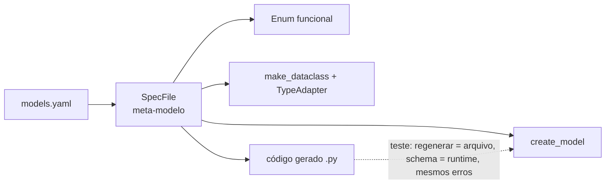

# Dataclass factory — configuração, fábricas e modelos a partir de arquivos

> Notebooks: [`01`](01_formatos_de_configuracao.ipynb) formatos de configuração · [`02`](02_factory_pattern.ipynb) factory pattern ·
> [`03`](03_configuracao_tipada.ipynb) configuração tipada · [`04`](04_politicas_e_presets.ipynb) políticas e presets ·
> [`05`](05_modelos_a_partir_de_especificacao.ipynb) modelos a partir de especificação · [`06`](06_caso_completo.ipynb) caso completo.
> Arquivos: [`configs/`](configs/) (exemplos), [`validadores.py`](validadores.py) (funções referenciadas por nome),
> [`generated/modelos_gerados.py`](generated/modelos_gerados.py) (gerado pelo notebook 05).

## A pergunta da pasta

"Dá para ter um arquivo de configuração que descreva dados, comportamento de modelos — ou os próprios modelos?" Dá, em quatro níveis
de ambição crescente. Cada nível tem um custo, e o primeiro que resolve o problema é o certo.

```
nível 1  arquivo descreve DADOS de configuração         → validar com modelo (03)            quase sempre vale
nível 2  arquivo escolhe QUAL objeto construir           → fábrica + união discriminada (02)  vale para plugins/canais/estratégias
nível 3  arquivo descreve COMPORTAMENTO dos modelos      → perfis validados (04)              raramente; presets em código primeiro
nível 4  arquivo descreve os PRÓPRIOS MODELOS            → meta-modelo + gerador (05)         só se a especificação for a fonte da verdade
```

Princípio que atravessa tudo: **o arquivo é texto não confiável**. O parser não garante tipos; quem garante é a validação, que
roda uma vez, na fronteira, antes de qualquer efeito colateral.

## 1. Formatos ([01](01_formatos_de_configuracao.ipynb))

| formato | tipos | datas | `null` | comentários | pegadinha verificada |
|---|---|---|---|---|---|
| JSON | básicos | ❌ | ✅ | ❌ | sem comentários nem vírgula final |
| TOML | básicos + datas | ✅ | **❌** | ✅ | "sem valor" = omitir a chave; `tomllib` só lê (modo binário) |
| YAML | inferência implícita | ✅ | ✅ | ✅ | `NO`→`False`, `010`→`8`, `3:30`→`210`, `1.10`→`1.1` (YAML 1.1); use `safe_load` |
| INI | só `str` | ❌ | ❌ | ✅ | chaves em minúsculas; `DEFAULT` vaza para todas as seções; `%` quebra a interpolação |
| `.env` / env | só `str` | ❌ | ❌ | ✅ | plano; aninhamento por convenção (`A__B`) |

Depois da validação, o formato deixa de importar: o notebook 01 carrega os cinco arquivos num único modelo e obtém objetos iguais.
Escolha padrão: **TOML** para configuração de projeto; YAML quando a estrutura é profunda (sempre com validação estrita); env para
segredos e ajustes de implantação.

## 2. Fábricas ([02](02_factory_pattern.ipynb))



| técnica | escolhe o tipo | valida parâmetros | risco principal |
|---|---|---|---|
| `if/elif` | código | não | cresce sem controle |
| registro `dict[Enum, type]` | Enum fechado | só aridade | esquecer de registrar → teste "todo membro tem fábrica" |
| decorador / `__init_subclass__` | registro distribuído | só aridade | registro depende de **import**; quebra com `slots=True` (ver §4) |
| Enum que carrega a classe | o membro | só aridade | `def` no corpo do Enum **não** vira membro (use `enum.member`) |
| união discriminada (Pydantic) | campo `kind` (ou função) | **sim** | — (é o padrão para configuração) |
| abstract factory | ambiente/perfil | por fábrica | famílias incoerentes se misturadas à mão |
| entry points | metadados de pacote | o plugin | plugin quebrado só aparece ao carregar |

Combinação recomendada para configuração: **união discriminada para validar + registro `Spec → componente` para construir**, com
os componentes como dataclasses sem dependência do Pydantic (notebooks 02 §7 e 06).

## 3. Configuração tipada e camadas ([03](03_configuracao_tipada.ipynb))

| caminho | converte | valida | aninhado | observação verificada |
|---|---|---|---|---|
| `Dataclass(**d)` | ❌ | ❌ | ❌ | anotações são documentação; `server` continua `dict` |
| conversor com `get_type_hints` | o que você escrever | parcial | ✅ | sem caminho do erro, sem restrições |
| `TypeAdapter(Dataclass)` | ✅ | ✅ | ✅ | extras **ignorados** por padrão; `__pydantic_config__ = {"extra": "forbid"}` (um `dict`, sem importar o Pydantic) resolve e vale para as aninhadas; `TypeAdapter(..., config=)` é recusado para dataclasses |
| `pydantic.dataclasses` / `BaseModel` | ✅ | ✅ | ✅ | validação sempre ligada |
| `BaseSettings` | ✅ | ✅ | ✅ | camadas com precedência; `extra="forbid"` **não** cobre variáveis de ambiente com erro de digitação |

```
argumentos  >  variáveis de ambiente  >  arquivo do ambiente (só diferenças)  >  arquivo base  >  defaults
```

- Merge **aninhado** (`deep_merge=True` no `YamlConfigSettingsSource`, ou um `deep_merge` próprio); decida explicitamente se listas
  **substituem** ou **concatenam** (o caso completo substitui).
- `frozen=True` é **raso**: congele cada submodelo e use `tuple`/`frozenset`.
- Segredos em `SecretStr`: mascarados em `repr` e no `model_dump_json`.
- Enums lidos por nome/caixa: prefira `BeforeValidator` na leitura a `_missing_` (que muda o Enum para todo mundo).

## 4. Políticas e presets ([04](04_politicas_e_presets.ipynb))

**Padrão:** classe base por perfil (Pydantic) e `partial(dataclass, ...)` por perfil (stdlib), em código.

**Se o perfil for para um arquivo**, valide o próprio arquivo (`ModelPolicy`): chaves fechadas, tipos estritos, regras de
coerência e registro para funções. O `data_model.yaml` original mostrou o porquê:

| achado (verificado) | consequência |
|---|---|
| `strict` + `coerce_numbers_to_str` | a segunda opção é letra morta |
| `strict` + enum | `"red"` recusado num `dict`, aceito vindo de JSON |
| chave com erro de digitação | ignorada sem aviso |
| `populate_by_name` | renomeado para `validate_by_name` |
| `frozen` → "hashable" | só se **todos** os campos forem hashable; e é raso |

Pegadinhas do `@dataclass` verificadas: frozen não herda de não-frozen; `order=True` exige `eq=True`; **`slots=True` recria a classe
e chama `__init_subclass__` de novo sem os argumentos de classe** — autorregistro com `kind=...` quebra, e torná-lo opcional registra
a classe errada (use `ClassVar` + sobrescrita, ou decorador depois do `@dataclass`); `frozen` no decorador **e** no `config` de uma
dataclass do Pydantic gera aviso.

Regra de contrato: o perfil de cada modelo é decisão de código; o arquivo define o que o perfil significa, **igual em todos os
ambientes**.

## 5. Modelos a partir de especificação ([05](05_modelos_a_partir_de_especificacao.ipynb))



O meta-modelo recusa ao carregar: tipo desconhecido, chave com erro de digitação, restrição incompatível com o tipo, `pattern` sem
âncora, nome de campo inválido em Python, `default: null` sem `nullable`, função inexistente no registro, enum com valor repetido,
modelo fora de PascalCase, ciclo entre modelos. O que só o construtor pega: default que viola a própria restrição.

Lições de ordem de execução (verificadas):
- restrições (`pattern`, `min_length`) rodam **antes** de `AfterValidator` → normalização (`upper`, `strip`) é `BeforeValidator`;
- vários `BeforeValidator` rodam em **ordem inversa** à declarada → o construtor inverte a lista;
- `Field(...)` **antes** do `BeforeValidator` no `Annotated` mantém a mensagem de erro específica do tipo;
- defaults não são validados → default `2` num campo `Priority` fica `int` (e o serializador avisa) se o construtor não converter.

| alvo | valida | tipagem estática | `pickle` | quando |
|---|---|---|---|---|
| `create_model` | ✅ | ❌ | ❌ sem nome importável | modelos que mudam sem deploy |
| `make_dataclass` + `TypeAdapter` | ✅ (via adapter) | ❌ | ❌ | domínio sem Pydantic |
| **código gerado** | ✅ | ✅ (com `init_typed = True` no plugin do mypy) | ✅ | **padrão** |

Diferença verificada entre alvos: `strict=True` numa **dataclass** aninhada exige instância exata (recusa `dict`); num `BaseModel`
aninhado, `dict` é aceito. O construtor de dataclasses aplica `Strict()` por campo.

Antes de construir o seu meta-modelo, considere o pronto: JSON Schema + `datamodel-codegen` (curso, seção 12). O valor do meta-modelo
próprio está nas **regras sobre os seus modelos** (vocabulário fechado, padrões ancorados, perfis aprovados).

## 6. Caso completo ([06](06_caso_completo.ipynb))

Pipeline de exportação: camadas YAML → `PipelineSpec` (uniões discriminadas, `Literal` gerado dos campos de `Venda`, regras de
produção no modelo) → registro `Spec → componente` com teste de cobertura → componentes dataclass → `Venda` validada linha a linha com
número da linha → sinks. Erros de configuração chegam com caminho e camadas envolvidas; ruído de `too_short` em coleções é filtrado.

## Índice de pegadinhas, efeitos colaterais e caveats

Cada notebook termina com uma seção **"⚠️ Pegadinhas, efeitos colaterais e caveats"**: um quadro das que aparecem no corpo e as
novas, cada uma com demonstração executável e a forma de evitar.

| notebook | novas na seção final |
|---|---|
| [01](01_formatos_de_configuracao.ipynb) | âncoras YAML compartilham o objeto · chaves duplicadas (última vence; loader/hook que recusam) · comentário inline no INI vira valor · `NaN`/`Infinity` no JSON e no `float` do Pydantic (`FiniteFloat`) · `.env` expande `${VAR}` até entre aspas simples · YAML vazio = `None`, data impossível estoura no parser · `float` para dinheiro · codificação |
| [02](02_factory_pattern.ipynb) | *late binding* de `lambda` no registro · `__init_subclass__` obrigatório impede bases intermediárias · `kind` com default não dispensa a tag na entrada · união sem discriminador escolhe por heurística (erro de digitação cai na classe errada) · registro global vaza entre testes · `@cache` em fábrica compartilha objeto mutável · atributo mutável em membro de Enum é estado global |
| [03](03_configuracao_tipada.ipynb) | lista via env precisa ser JSON · `bool` vazio no env derruba a carga · `SecretStr` + dump + recarga = senha `**********` · `@lru_cache` em `get_settings()` congela a configuração · caminho relativo ao cwd, não ao arquivo · `os.environ` vaza entre testes |
| [04](04_politicas_e_presets.ipynb) | `validate_assignment` não vê `append` · `alias_generator` só na saída com `by_alias` (`serialize_by_alias`) · `str_to_lower` não vale para Enum · `model_copy(update=)`/`model_construct` pulam validação mesmo em `frozen` · `use_enum_values` com default deixa tipos misturados · herança de `model_config` e raio de impacto do preset |
| [05](05_modelos_a_partir_de_especificacao.ipynb) | **injeção de código pelo gerador** · dois campos disputando o mesmo alias (ambos preenchidos) · campo que sombreia o `BaseModel` · valores de enum que colapsam no mesmo nome · cache de imports após regenerar · executar configuração = mudar contrato sem revisão |
| [06](06_caso_completo.ipynb) | número BRL ingênuo erra 10× (`"1.5"` → `15`) · seção vazia numa camada apaga a de baixo · gerador consumido duas vezes · CSV irregular (`None` como chave) · efeitos parciais entre destinos · reexecução sobrescreve a saída |

Seis desses itens eram **bugs do próprio material**, achados ao escrever esta seção e corrigidos no código principal (a seção de
caveats mostra a versão ingênua e a corrigida): injeção no gerador, colisão de alias e sombreamento não detectados pelo
meta-modelo, colapso de nomes de enum (05); conversão BRL ambígua e merge com seção vazia (06).

## Checklist

- [ ] `safe_load`; strings ambíguas entre aspas no YAML
- [ ] validação na fronteira, uma vez, antes de efeitos colaterais; `extra="forbid"` em tudo que vem de arquivo
- [ ] erros com **caminho** (`server.port`) e **origem** (qual arquivo/camada)
- [ ] vocabulários como `Enum`; teste "todo membro tem fábrica"
- [ ] configuração congelada em **todos** os níveis
- [ ] segredos fora do repositório, em `SecretStr`
- [ ] nada que mude o contrato variando por ambiente
- [ ] código gerado versionado + teste "regenerar não muda nada"; textos da especificação entram só via `repr`
- [ ] coleções em configuração como `tuple`; nada de mutar o que foi carregado
- [ ] efeitos colaterais (escrita, rede) só depois de **toda** a validação; destinos idempotentes ou com relatório por destino
