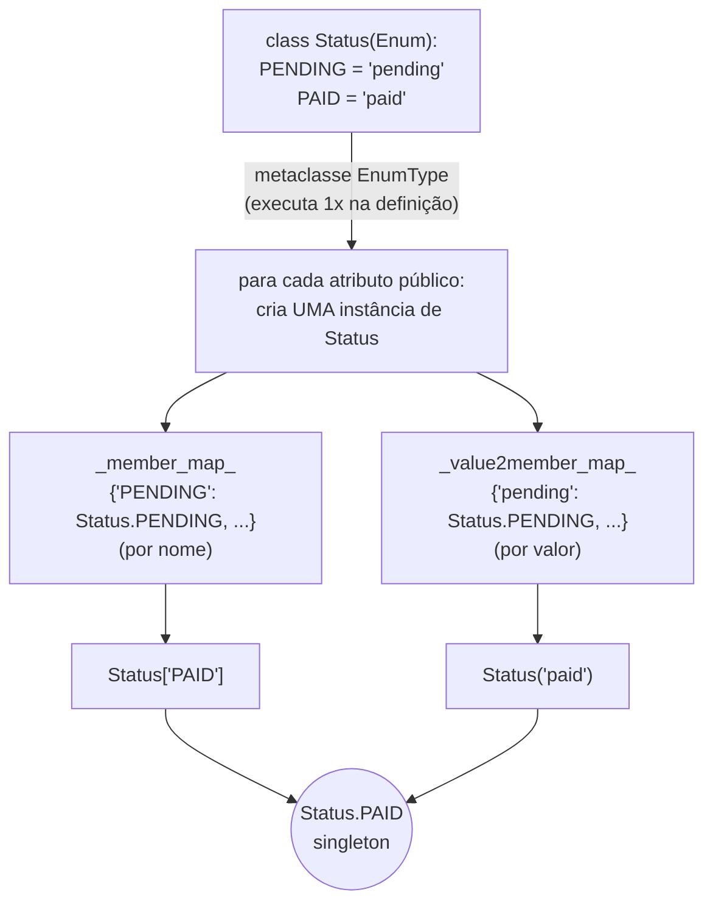
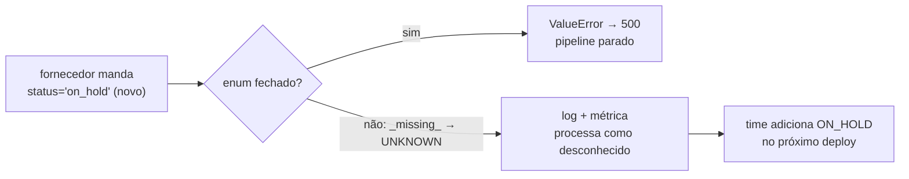

# Enum — Teoria

> Versão de referência: **Python 3.13** (módulo `enum` da biblioteca padrão; versão mínima indicada quando > 3.4).
> Notebooks deste módulo: [`01_enum_basico`](01_enum_basico.ipynb) · [`02_enum_intermediario`](02_enum_intermediario.ipynb) · [`03_enum_avancado`](03_enum_avancado.ipynb)

> Cada notebook termina com uma seção **⚠️ Pegadinhas, efeitos colaterais e caveats** (as já vistas no corpo + novas, com demonstração).

---

## 1. O que é

Um `Enum` é um **conjunto fechado de constantes nomeadas**. Cada membro é um objeto único (singleton) com um
`name` (o identificador) e um `value` (o dado associado). O conjunto é fixo: não dá para criar membros novos depois que
a classe existe, nem alterar os que existem.

```python
class OrderStatus(Enum):
    PENDING = "pending"
    PAID = "paid"
    SHIPPED = "shipped"
```

`OrderStatus.PAID` não é a string `"paid"`: é **o** membro `PAID`, que *carrega* o valor `"paid"`.

## 2. Que problema resolve

Valores "mágicos" espalhados pelo código — strings e números soltos — são uma das fontes mais comuns de bug silencioso:

```
  SEM ENUM                                        COM ENUM
  ──────────────────────────────────               ────────────────────────────────────
  if order.status == "shiped":   # typo            if order.status is OrderStatus.SHIPED
      notify()                   # nunca roda  ⟶       → AttributeError na hora (e o editor avisa)
  set_status(order, 3)           # 3 = ?           set_status(order, OrderStatus.SHIPPED)
  "Paid" vs "paid" vs "PAID"     # 3 grafias        um único membro, um único valor
  quais status existem? → grep    no projeto        list(OrderStatus)
```

O Enum transforma um **vocabulário implícito** (que só existe na cabeça das pessoas) em um **tipo explícito**:
o editor autocompleta, o type checker verifica, `match/case` pode ser exaustivo e a lista de opções vira documentação
(e JSON Schema, quando usado com Pydantic).

## 3. Como funciona por dentro



* A metaclasse `EnumType` (antes `EnumMeta`) intercepta a criação da classe: cada atributo público vira **uma instância** da própria classe.
* Ela guarda dois índices: **por nome** (`Status["PAID"]`) e **por valor** (`Status("paid")`). Ambos são buscas em dicionário.
* Membros são **singletons**: `Status("paid") is Status.PAID` é sempre `True` — por isso a comparação idiomática é `is`.
* Dois nomes com o mesmo valor criam um **alias** (o segundo aponta para o primeiro membro), a menos que você use `@unique`.
* Membros sobrevivem a `pickle`/`copy` mantendo a identidade.

## 4. A família de tipos

| tipo | desde | valor | compara com o valor bruto? | uso típico |
|---|---|---|---|---|
| `Enum` | 3.4 | qualquer | **não** (`Status.PAID == "paid"` → `False`) | vocabulário de domínio, estado |
| `IntEnum` | 3.4 | `int` | sim (é subclasse de `int`) | códigos numéricos de protocolos, compatibilidade com código legado |
| `StrEnum` | 3.11 | `str` | sim (é subclasse de `str`) | valores que viram JSON, headers, nomes de coluna, chaves de config |
| `Flag` | 3.6 | potências de 2 | não | **combinação** de opções (`READ \| WRITE`) |
| `IntFlag` | 3.6 | potências de 2 | sim | flags que precisam se misturar com `int` (permissões de SO, bitmasks de C) |

```
                  ┌───────── Enum ─────────┐
                  │  membros únicos,        │
                  │  1 estado por vez       │
                  └──┬──────────┬───────────┘
          mistura com│int       │mistura com str        combinação de bits
                ┌────▼───┐  ┌───▼─────┐            ┌──────────────┐
                │IntEnum │  │ StrEnum │            │    Flag      │──► IntFlag (mistura com int)
                └────────┘  └─────────┘            └──────────────┘
```

**Regra de escolha:** comece com `Enum` (mais seguro: não se confunde com valores brutos). Use `StrEnum` quando o
valor vai e volta de JSON/HTTP/banco o tempo todo e você quer `==` com a string. Use `IntEnum`/`IntFlag` apenas quando
precisar interoperar com APIs numéricas. Use `Flag` quando um objeto pode ter **várias** opções ao mesmo tempo.

## 5. Mapa de capacidades

| capacidade | API | notebook |
|---|---|---|
| acesso | `.name`, `.value`, `Status["PAID"]`, `Status("paid")` | 01 |
| iteração / tamanho / pertinência | `list(Status)`, `len(Status)`, `"paid" in Status` (3.12+) | 01 |
| valores automáticos | `auto()`, `_generate_next_value_` | 01, 02 |
| aliases e unicidade | nomes com o mesmo valor, `@unique`, `__members__` | 01 |
| despacho | `match/case` | 01 |
| tipos mistos | `IntEnum`, `StrEnum` | 02 |
| combinação | `Flag`, `IntFlag`, `\|`, `&`, `~`, `in` | 02 |
| comportamento | métodos, `@property`, `@classmethod` dentro do Enum | 02 |
| parsing tolerante | `_missing_` (case-insensitive, sinônimos, fallback) | 02 |
| membros ricos | `__new__`/`__init__` com tuplas (valor + atributos) | 02 |
| validação da definição | `@verify(UNIQUE, CONTINUOUS, NAMED_FLAGS)` (3.11) | 02 |
| integração | Pydantic (`use_enum_values`, JSON Schema), dataclass, JSON, config | 02 |
| máquina de estados | transições declaradas no próprio Enum | 03 |
| estratégia | `member()` com funções como valor (3.11) | 03 |
| API funcional | `Enum("Nome", [...])` — enums gerados em runtime | 03 |
| fronteira de Flags | `FlagBoundary` (`STRICT`, `CONFORM`, `EJECT`, `KEEP`) | 03 |
| evolução de API | enum "aberto" com `UNKNOWN` via `_missing_` | 03 |
| exaustividade | `typing.assert_never` | 03 |
| persistência | gravar `value` (não `name`, nem posição) | 03 |

## 6. Enum para arquivos de configuração

Configuração é cheia de "conjunto fechado de opções": ambiente, nível de log, backend de cache, estratégia de retry,
região, modo de execução. Representá-las como `str` deixa passar `"prodution"` e `"Info"`.

```
  config.yaml / env var               Enum                        código
  ────────────────────────            ─────────────────            ──────────────────────────────
  environment: "PROD"   ──_missing_──► Environment.PROD   ──────►  if env is Environment.PROD: ...
  log_level: "info"     ──StrEnum────► LogLevel.INFO      ──────►  logging.setLevel(level.value)
  cache: "redis"        ──────────────► CacheBackend.REDIS ─────►  BACKENDS[cache]()   (dict de dispatch)
  features: "a,b"       ──Flag parse──► Feature.A | Feature.B ──►  if Feature.B in features: ...
```

* Com **Pydantic/pydantic-settings**, um campo `environment: Environment` já valida e converte a string — e a mensagem de
  erro lista as opções válidas.
* `_missing_` permite aceitar variações (`"PROD"`, `"production"`) sem espalhar `lower()` pelo código.
* `Flag` representa **conjuntos** de feature flags num único valor.
* Membros podem carregar **metadados** (timeout padrão por ambiente, custo por modelo, etc.), mantendo a tabela de
  decisão junto com o vocabulário.

## 7. Enum na camada de dados de APIs e aplicações

| onde | papel do Enum |
|---|---|
| **request/response DTO** | restringe o campo (`status: OrderStatus`) → 422 automático para valor inválido |
| **OpenAPI / JSON Schema** | vira `"enum": [...]` — clientes geram tipos (`"pending" \| "paid"`) automaticamente |
| **banco de dados** | grava o `value` (estável), nunca a posição; ORMs mapeiam para coluna `VARCHAR`/`ENUM` |
| **domínio** | estados, tipos, categorias; transições de estado validadas |
| **mensageria/eventos** | tipo do evento (`"order.paid"`) como `StrEnum`, usado em uniões discriminadas |
| **permissões** | `Flag` para combinar papéis/escopos |
| **LLMs** | rótulos de classificação/roteamento com saída **restrita** ao conjunto (ver `AI_use_cases`) |

### Contrato fechado × aberto

Enums são **fechados** por definição. Em APIs que você **consome**, o fornecedor pode adicionar um valor novo amanhã — e um
enum fechado quebra o seu parser em produção. Estratégia: na entrada de dados externos, um enum "aberto" com membro
`UNKNOWN` via `_missing_` (registrando o valor desconhecido); nas APIs que você **expõe**, enum fechado (o cliente precisa saber
tudo o que pode receber, e adicionar valor novo é *breaking change* para quem faz `match` exaustivo).



## 8. Performance

* Acessar `Status.PAID` é um acesso a atributo de classe (rápido).
* `Status("paid")` e `Status["PAID"]` são buscas em dicionário (rápidas), com uma camada de chamada da metaclasse.
  Em loops muito quentes (milhões de conversões), um `dict` pré-montado (`_value2member_map_` ou o seu próprio) é mais rápido.
* Comparar com `is` é a operação mais barata possível (identidade).
* Membros não ocupam memória por uso: há **uma** instância de cada, compartilhada por todo o programa.

## 9. Armadilhas comuns

1. **`Enum` ≠ valor bruto** — `Status.PAID == "paid"` é `False` com `Enum` puro. Compare com o membro, ou use `StrEnum`.
2. **`str()` e `format()` diferem entre tipos** — `str(Color.RED)` → `"Color.RED"` (Enum) mas `str(S.A)` → `"a"` (StrEnum). Em f-strings de log/SQL isso muda o resultado.
3. **Aliases silenciosos** — dois membros com o mesmo valor: o segundo vira apelido e **some** da iteração. Use `@unique`.
4. **`Flag` com valor que não é potência de 2** — vira um *alias de combinação* (`BLACK = 12` é `YELLOW | BLUE`) e também some da iteração.
   Nenhum validador do `enum` barra isso (nem `@verify(NAMED_FLAGS)`, que só pega bits sem nome). Correção: `auto()` para opções
   independentes; para combinação intencional, escreva com nomes (`BLACK = YELLOW | BLUE`) e teste os aliases esperados (código em `02_enum_intermediario`).
5. **Persistir `name` ou posição** — renomear um membro ou reordenar quebra dados salvos. Persista o `value` e trate-o como contrato.
6. **Anotar membros** — `RED: str = "R"` funciona em runtime, mas a especificação de tipagem pede **sem anotação** nos membros; type checkers reclamam.
7. **`auto()` em `Enum` puro gera inteiros** (1, 2, 3...). Se os números forem persistidos, reordenar membros muda os valores. Em `StrEnum`, `auto()` gera o nome em minúsculas.
8. **Métodos viram membros?** — funções definidas no corpo **não** viram membros (descritores são ignorados), mas `lambda` atribuída a um nome **também não**. Para guardar uma função como valor use `enum.member(...)` (3.11+).
9. **Herdar de um Enum com membros** — proibido. Só se herda de Enums sem membros (para compartilhar métodos).

## 10. Quando usar e quando não usar

**Use** para: estados, tipos, categorias, níveis, papéis, códigos de erro do seu sistema, opções de configuração,
rótulos de classificação, nomes de eventos, combinações de permissões (`Flag`).

**Não use** para: conjuntos que mudam com frequência sem deploy (categorias cadastradas pelo usuário → tabela no banco),
listas muito grandes (milhares de códigos — use tabela/dicionário), ou quando um simples `Literal["a", "b"]` em um único
campo já basta e não há comportamento associado.

## 11. Roteiro de estudo

| Nível | Notebook | Você sai sabendo |
|---|---|---|
| Básico | `01_enum_basico.ipynb` | definir, acessar por nome/valor, iterar, `auto()`, aliases, `@unique`, `is`, `match/case` |
| Intermediário | `02_enum_intermediario.ipynb` | `StrEnum`/`IntEnum`, `Flag`/`IntFlag` (e a pegadinha do alias), métodos, `_missing_`, membros ricos, `@verify`, integração com config, JSON, dataclass e Pydantic |
| Avançado | `03_enum_avancado.ipynb` | máquina de estados, estratégia com `member()`, API funcional, `FlagBoundary`, enum aberto para APIs externas, `assert_never`, persistência, performance |

## Referências

* Documentação: <https://docs.python.org/3/library/enum.html>
* HOWTO (excelente): <https://docs.python.org/3/howto/enum.html>
* Typing spec — enums: <https://typing.python.org/en/latest/spec/enums.html>
