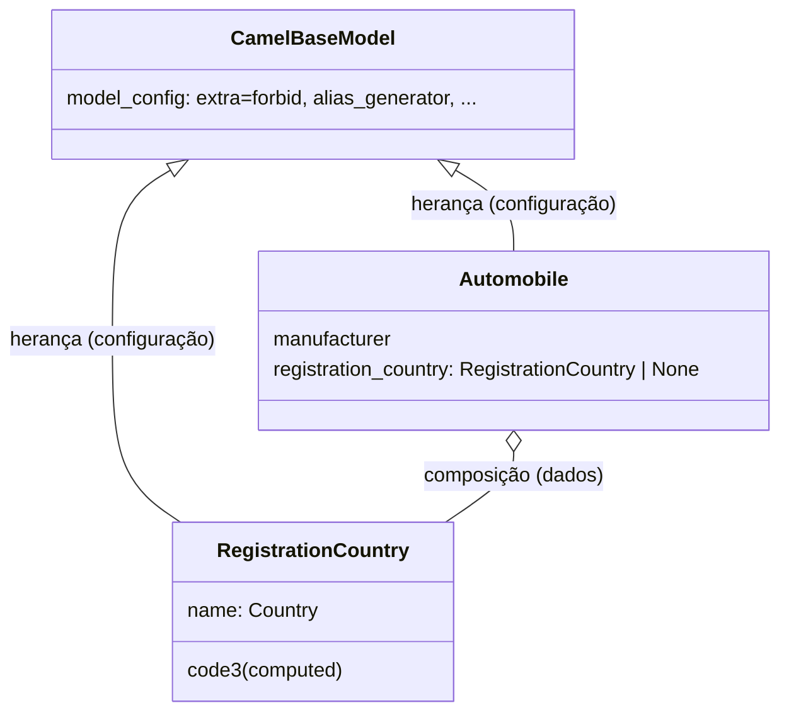

# Seção 11 — Modelos complexos: teoria

> Notebooks: [`02`](02_composicao_de_modelos.ipynb) composição · [`03`](03_heranca_de_modelos.ipynb) herança · projeto: [`04`](04_projeto.ipynb) ·
> [`05`](05_projeto_solucao_instrutor.ipynb) · [`06`](06_projeto_solucao_final_instrutor.ipynb) · [`07`](07_projeto_solucao_comentada.ipynb)
> ⚠️ Pegadinhas, efeitos colaterais e caveats da seção: [`99_pegadinhas_e_caveats`](99_pegadinhas_e_caveats.ipynb)

## Composição × herança

| | composição | herança |
|---|---|---|
| relação | "tem um" (campo cujo tipo é outro modelo) | "é um" (subclasse) |
| serialização | gera estruturas **aninhadas** | campos da mãe + da filha no mesmo nível |
| configuração | cada submodelo tem a **sua** | `model_config` da filha é **mesclado** com o da mãe |
| uso típico | payloads aninhados de APIs; descartar o que não interessa com `extra="ignore"` por submodelo | base com configuração padrão (`CamelBaseModel`); base de respostas com metadados (`ResponseBaseModel`) |

Aviso do instrutor (vale repetir): evite **herança múltipla** com modelos Pydantic — quebrou na migração V1→V2 no caso dele.

## Detalhes que pegam

- `exclude` aninhado: `model_dump(exclude={"registration_country": {"code3"}})`; para listas, a chave é o índice ou `"__all__"`.
- Submodelo `frozen=True` + `cached_property`: o cache nunca fica velho; trocar o país = trocar o objeto (validado por `validate_assignment`).
- Erros de submodelos vêm com a localização completa: `('registrationCountry', 'name')`.

## Divergências encontradas na revisão

- Composição: `Point2D.y` com `gt=0` rejeita o próprio exemplo seguinte (`y=-5`); o notebook original registra o erro. Corrigido.
- Composição: o texto cita *awards*, mas o modelo não tem o campo; `extra="ignore"` já é o padrão.
- Herança: `query_id: uuid4` usa a **função** como tipo — UUIDs vindos de fora são rejeitados e o schema vira objeto vazio. Correto: `UUID4`.
- Projeto: os bugs da seção 9 migraram para `RegistrationCountry` (`name` anulável → `KeyError` em `code3`; cache desatualizado).
