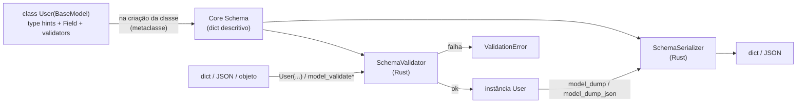
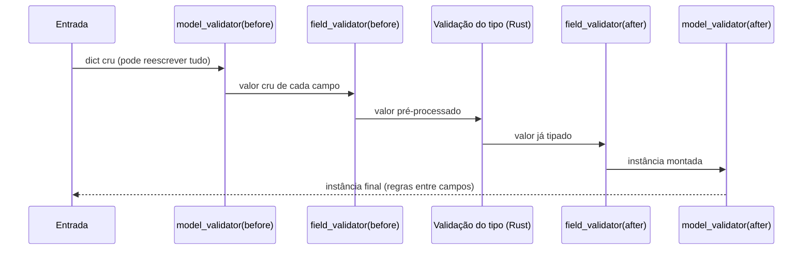
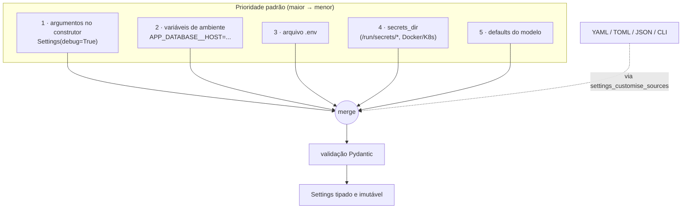

# Pydantic — Teoria

> Versão de referência: **Pydantic 2.13** + **pydantic-settings 2.16** (Python ≥ 3.10).
> Notebooks deste módulo: [`01_pydantic_basico`](01_pydantic_basico.ipynb) · [`02_pydantic_intermediario`](02_pydantic_intermediario.ipynb) · [`03_pydantic_avancado`](03_pydantic_avancado.ipynb)
> Curso completo (11 seções, aulas + projetos resolvidos): [`complete/`](complete/README.md)

> Cada notebook termina com uma seção **⚠️ Pegadinhas, efeitos colaterais e caveats** (as já vistas no corpo + novas, com demonstração).

---

## 1. O que é

Pydantic é uma biblioteca de **validação, conversão (parsing) e serialização de dados** guiada por *type hints*.
Você declara a forma dos dados como uma classe; o Pydantic garante, em tempo de execução, que qualquer objeto
criado a partir dessa classe **respeita o contrato** — ou levanta um `ValidationError` explicando exatamente o que está errado.

Desde a v2 (2023), o motor de validação é o **`pydantic-core`**, escrito em Rust. A parte Python (o que você
importa) só monta um *schema* a partir das suas anotações; quem executa a validação é o código compilado.
Isso deixou a v2 entre 5x e 50x mais rápida que a v1 dependendo do caso.

## 2. Que problema resolve

Todo sistema tem uma **fronteira de confiança**: o ponto onde dados de fora (HTTP, arquivos, filas, variáveis de
ambiente, saída de LLM) entram no código que você controla. Do lado de fora, tudo é `dict`, `str` e `bytes` sem garantia.
Do lado de dentro, você quer objetos tipados em que pode confiar sem `if` defensivo em todo lugar.

```
             MUNDO EXTERNO (não confiável)          │          SEU DOMÍNIO (confiável)
                                                     │
  JSON de API ─┐                                     │
  .env / YAML ─┼──►  dict / str / bytes  ──► [ PYDANTIC ] ──► objetos tipados ──► regras de negócio
  formulário ──┤                              valida     │
  saída LLM  ──┘                              converte   │
                                              rejeita ───┼──► ValidationError (422, log, retry)
```

Sem Pydantic, esse trabalho vira dezenas de `isinstance`, `try: int(x)`, `.get()` com default e mensagens de erro
inconsistentes, espalhados pelo código. Com Pydantic, a regra mora **num lugar só**: a definição do modelo.

O princípio por trás é o **"parse, don't validate"**: em vez de checar um dado e continuar usando o `dict` cru,
você o *transforma* num tipo que, por construção, só existe se for válido. Depois da fronteira, ninguém precisa
revalidar.

## 3. Como funciona por dentro



1. **Criação da classe** — a metaclasse do `BaseModel` lê as anotações, `Field(...)`, validators e `model_config`
   e gera um *core schema*. Esse custo é pago **uma vez**, no import (pode ser adiado com `defer_build=True`).
2. **Validação** — `SchemaValidator` percorre a entrada e produz a instância. Existem dois caminhos:
   `validate_python` (entrada já é objeto Python) e `validate_json` (entrada é `str`/`bytes`; o parse do JSON
   acontece **dentro do Rust**, sem passar por `json.loads` — por isso é mais rápido).
3. **Serialização** — `SchemaSerializer` faz o caminho inverso, em modo `python` (mantém `datetime`, `UUID`...) ou
   `json` (tudo vira tipo compatível com JSON).

### 3.1 Ordem de execução dos validators



* **before** recebe o dado cru — use para normalizar formatos estranhos ("1.234,56" → 1234.56).
* **after** recebe o dado já convertido para o tipo — use para regras de negócio ("data no futuro").
* **wrap** envolve a validação padrão (você decide se chama o `handler`) — use para fallback/tolerância.
* **plain** substitui a validação padrão por completo.
* `model_validator(mode="after")` é o lugar de **regras entre campos** (`start < end`, `password == confirm`).

### 3.2 Modo *lax* × *strict*

Por padrão o Pydantic é **lax**: tenta converter valores compatíveis.

| Entrada  | Tipo alvo | lax (padrão)       | strict       |
|----------|-----------|--------------------|--------------|
| `"42"`   | `int`     | `42`               | erro         |
| `42.0`   | `int`     | `42`               | erro         |
| `42.5`   | `int`     | **erro** (perderia dado) | erro   |
| `"yes"`  | `bool`    | `True`             | erro         |
| `42`     | `str`     | **erro** (v2 não converte número→str) | erro |
| `"2026-11-10"` | `date` | `date(2026,11,10)` | erro em Python / ok em JSON |

O modo lax é ótimo para entradas humanas e JSON (que não tem tipo `date`, por exemplo). O strict é ótimo para
dados internos em que uma conversão silenciosa esconderia bug. Dá para ligar strict por modelo
(`ConfigDict(strict=True)`), por campo (`Field(strict=True)`) ou por chamada (`model_validate(x, strict=True)`).

## 4. Mapa de capacidades

| Capacidade | API | Para que serve | Notebook |
|---|---|---|---|
| Modelo declarativo | `BaseModel`, type hints | Contrato do dado | 01 |
| Restrições | `Field(gt=, max_length=, pattern=)`, `Annotated` | Limites de valor sem código | 01 |
| Tipos prontos | `EmailStr`, `HttpUrl`, `SecretStr`, `UUID`, `Decimal`, `Literal` | Formatos comuns validados | 01 |
| Modelos aninhados | campos do tipo `OutroModel`, `list[Model]` | Estruturas de árvore (JSON) | 01 |
| Serialização | `model_dump`, `model_dump_json`, `include/exclude` | Saída para API/arquivo | 01 |
| Validators | `field_validator`, `model_validator`, `AfterValidator`... | Regras de negócio | 02 |
| Configuração do modelo | `ConfigDict(extra=, frozen=, strict=, ...)` | Política do contrato | 02 |
| Aliases | `alias`, `alias_generator`, `AliasChoices`, `AliasPath` | camelCase ↔ snake_case, APIs bagunçadas | 02 |
| Campos derivados | `computed_field`, `PrivateAttr` | Dados calculados / estado interno | 02 |
| Leitura de ORM | `ConfigDict(from_attributes=True)` | Objeto ORM → DTO | 02 |
| Configuração de app | `pydantic-settings` (`BaseSettings`) | env vars, `.env`, YAML, TOML, secrets | 02 |
| Uniões discriminadas | `Field(discriminator=...)`, `Discriminator` | Eventos/webhooks polimórficos | 03 |
| Genéricos | `BaseModel, Generic[T]` | `Page[T]`, `ApiResponse[T]` | 03 |
| Validar qualquer tipo | `TypeAdapter`, `RootModel` | `list[User]`, `dict[str, int]` sem modelo | 03 |
| Tipos customizados | `__get_pydantic_core_schema__`, `Annotated[..., BeforeValidator, PlainSerializer]` | Tipos de domínio (Money, Coordenada) | 03 |
| Contexto | `context=` em validate/dump | Validação dependente de tenant/usuário | 03 |
| Serializers | `field_serializer`, `model_serializer` | Formato de saída customizado | 03 |
| JSON Schema | `model_json_schema()` | OpenAPI, contrato para clientes, **LLMs** | 03 |
| Funções validadas | `@validate_call` | Fronteira em funções | 03 |
| Performance | `validate_json`, `model_construct`, `defer_build` | Caminhos quentes | 03 |

## 5. Pydantic para arquivos de configuração

`pydantic-settings` é um pacote separado (`pip install pydantic-settings`) que traz a classe `BaseSettings`.
Ela é um `BaseModel` que, além de aceitar argumentos, **busca valores em várias fontes** e as mescla por prioridade.



Por que isso é melhor que `os.getenv` espalhado:

* **Fail fast** — a aplicação quebra no *startup* com uma mensagem clara ("`database.port`: Input should be a valid integer"),
  não às 3h da manhã quando o código finalmente lê a variável.
* **Tipagem** — `PORT=5432` vira `int`, `DEBUG=false` vira `bool`, `ALLOWED_HOSTS='["a","b"]'` vira `list[str]`.
* **Segredos** — `SecretStr` não aparece em `repr`, logs ou `model_dump()` acidentais.
* **Estrutura** — configurações aninhadas (`database.host`) com `env_nested_delimiter="__"` → `APP_DATABASE__HOST`.
* **Múltiplas fontes** — YAML/TOML versionados no repo para o padrão; env vars para sobrescrever por ambiente; secrets no cluster.
* **Imutabilidade** — `frozen=True` impede que alguém altere a config em tempo de execução.

Padrão recomendado: **uma** instância de `Settings` criada no startup e injetada (ou exposta por `functools.lru_cache`).

## 6. Pydantic na camada de dados de APIs

Numa API, o Pydantic costuma ocupar três papéis: **request DTO**, **response DTO** e **contrato público (OpenAPI)**.
O erro clássico é usar **um único modelo** para tudo — aí o `password_hash` vaza na resposta ou o cliente consegue
mandar `is_admin=true` na criação.

```
                 ┌──────────────┐  valida entrada   ┌────────────────┐   mapeia    ┌──────────────┐
  HTTP POST ───► │  UserCreate  │ ────────────────► │  serviço /     │ ──────────► │  ORM / DB    │
  (JSON)         │ email, senha │   extra=forbid    │  domínio       │             │  UserRow     │
                 └──────────────┘                   └────────────────┘             └──────┬───────┘
                 ┌──────────────┐  PATCH parcial                                          │
  HTTP PATCH ──► │  UserUpdate  │  exclude_unset=True                                     │
                 │ tudo opcional│                                                         │
                 └──────────────┘                                                         │
                 ┌──────────────┐  from_attributes=True                                   │
  HTTP 200  ◄─── │  UserPublic  │ ◄───────────────────────────────────────────────────────┘
  (JSON)         │ id, email    │   (nunca expõe hash)
                 └──────────────┘
```

Boas práticas:

* **Modelos separados por direção**: `XCreate`, `XUpdate`, `XPublic` (e `XInDB` se fizer sentido). Herança de um `XBase` evita repetição.
* **`extra="forbid"` na entrada**: campo desconhecido vira erro 422 — pega typo do cliente e tentativa de *mass assignment*.
* **PATCH com `exclude_unset=True`**: diferencia "não enviado" de "enviado como `null`".
* **Aliases** (`alias_generator=to_camel`) para expor `camelCase` em JSON mantendo `snake_case` no Python.
* **`from_attributes=True`** para construir o DTO de saída direto do objeto ORM.
* **Erros padronizados**: `ValidationError.errors()` já traz `loc`, `type`, `msg` — basta mapear para o formato de erro da API.
* **JSON Schema** gerado (`model_json_schema()`) alimenta OpenAPI/Swagger, geração de clientes e… *structured output* de LLMs (ver `AI_use_cases`).

O FastAPI faz quase tudo isso automaticamente: valida o corpo com o modelo do parâmetro, filtra a resposta com
`response_model` e devolve 422 com os erros do Pydantic.

## 7. Performance — onde ela importa

| Situação | Recomendação |
|---|---|
| Entrada é JSON (`str`/`bytes`) | `Model.model_validate_json(raw)` em vez de `Model(**json.loads(raw))` |
| Validar `list[Model]` ou tipos sem classe | Criar **um** `TypeAdapter` no nível do módulo e reutilizar |
| Dado já validado (ex.: veio do seu próprio banco) | `Model.model_construct(**data)` — **pula validação** (use com consciência) |
| Muitos modelos, startup lento | `ConfigDict(defer_build=True)` |
| Loop quente interno com milhões de objetos | Considere `dataclass(slots=True)` dentro do domínio e Pydantic só na borda |
| Validators em Python | Cada `field_validator` sai do Rust para o Python: prefira `Field(gt=..., pattern=...)` quando possível |

## 8. Armadilhas comuns

1. **`Optional[X]` não é "opcional"** — `x: int | None` sem default é *obrigatório* (pode ser `None`, mas precisa vir). Para opcional: `x: int | None = None`.
2. **Coerção silenciosa** — `"0"` vira `False` para `bool`, `"1e3"` vira `1000.0`. Se isso for perigoso no seu domínio, use strict.
3. **`model_dump()` não é JSON** — devolve `datetime`, `UUID`, `Decimal`. Para JSON: `model_dump(mode="json")` ou `model_dump_json()`.
4. **`model_copy(update=...)` não valida** — o `update` entra sem checagem.
5. **`validate_assignment` é `False` por padrão** — `user.age = "abc"` passa sem erro, a não ser que você ligue.
6. **Defaults mutáveis** — no Pydantic `tags: list[str] = []` é **seguro** (ele copia o default), diferente de dataclass. Mesmo assim, `Field(default_factory=list)` deixa a intenção explícita.
7. **Migração v1 → v2** — `dict()`→`model_dump()`, `json()`→`model_dump_json()`, `parse_obj`→`model_validate`, `class Config`→`model_config = ConfigDict(...)`, `@validator`→`@field_validator`, `orm_mode`→`from_attributes`.
8. **Uniões sem discriminador** — `A | B` usa o modo *smart* (tenta achar o melhor encaixe). Para payloads polimórficos, use discriminador: é mais rápido e o erro é mais claro.

## 9. Quando **não** usar

* Estruturas internas, já confiáveis, criadas em alta frequência → `dataclass(slots=True)`.
* Só um conjunto fechado de constantes → `Enum`.
* Projeto que não pode ter dependência externa → `dataclass` + validação manual.
* Throughput extremo de (de)serialização → avalie `msgspec`.

## 10. Comparativo rápido

| | `dataclass` | `pydantic.BaseModel` | `TypedDict` | `Enum` |
|---|---|---|---|---|
| Valida tipos em runtime | ❌ | ✅ | ❌ | (valores fixos) |
| Converte tipos | ❌ | ✅ (lax) | ❌ | `Enum(valor)` |
| Serialização JSON | manual | ✅ | é `dict` | `.value` |
| JSON Schema | ❌ | ✅ | via `TypeAdapter` | via Pydantic |
| Stdlib | ✅ | ❌ | ✅ | ✅ |
| Custo de criação | muito baixo | baixo (Rust) | zero (é dict) | zero (singletons) |
| Uso típico | domínio interno | bordas: API, config, LLM | tipar dicts | vocabulário fechado |

## 11. Roteiro de estudo

| Nível | Notebook | Você sai sabendo |
|---|---|---|
| Básico | `01_pydantic_basico.ipynb` | criar modelos, ler erros, usar `Field`, tipos prontos, aninhar e serializar |
| Intermediário | `02_pydantic_intermediario.ipynb` | validators, `ConfigDict`, aliases, DTOs de API (Create/Update/Public), `pydantic-settings` com env/.env/YAML/TOML, FastAPI |
| Avançado | `03_pydantic_avancado.ipynb` | uniões discriminadas, genéricos, `TypeAdapter`, tipos custom, contexto, serializers, JSON Schema, `validate_call`, performance, versionamento de contrato |

## Referências

* Documentação oficial: <https://docs.pydantic.dev/latest/>
* Settings: <https://docs.pydantic.dev/latest/concepts/pydantic_settings/>
* Guia de migração v1→v2: <https://docs.pydantic.dev/latest/migration/>
* "Parse, don't validate" (Alexis King): <https://lexi-lambda.github.io/blog/2019/11/05/parse-don-t-validate/>
