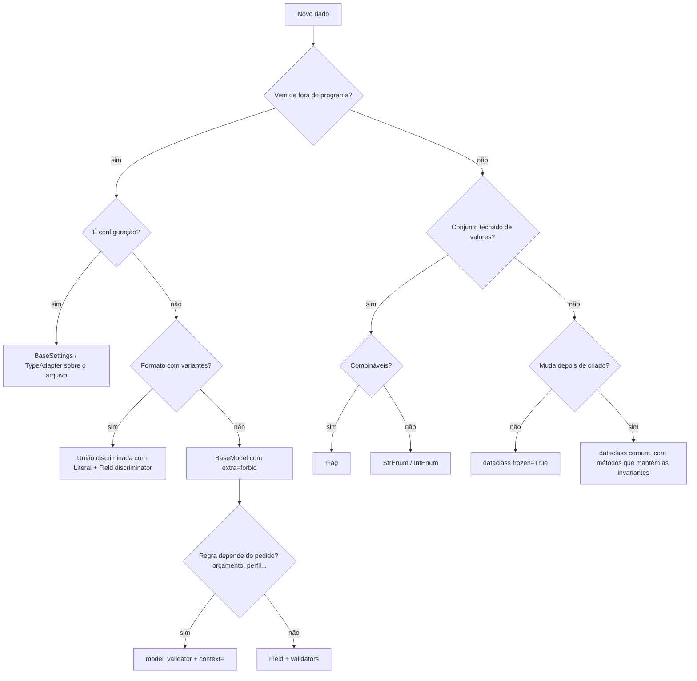

# Camadas de dados com Enum, Pydantic e dataclass

Guia de projeto, implementação e revisão. Base: estudo `dante-souza/studies`, pasta `data-and-classes/` (módulos
`enum/`, `dataclass/`, `pydantic/`, `dataclass_factory/` e a trilha `AI_use_cases/`, todos com notebooks executados).
Versão em inglês da mesma skill: `skills/data-layers-python/` (nomes, mensagens e comentários traduzidos).

**Marcas de confiança nas pegadinhas:** **(V)** verificada no estudo, com código executado; **(R)** observada em resposta
real de LLM; sem marca = comportamento conhecido da biblioteca, não testado no estudo.

**Versões testadas:** Python 3.13 (sintaxe compatível com 3.11), Pydantic 2.13.5 (cruzado com 2.14.3), pydantic-settings
2.16, openai 3.49, pydantic-ai 2.68, rich 15, SQLAlchemy 2.1, PyYAML 6.0.

## Como usar esta skill

1. Leia os **princípios**, a **árvore de decisão** e o **fluxo de trabalho** abaixo: eles decidem a ferramenta de cada dado.
2. Abra o **caso de uso** mais próximo da tarefa (tabela abaixo): cada um traz desenho, código, pegadinhas e possibilidades.
3. Antes de entregar, passe pelo [catálogo de pegadinhas](pegadinhas.md) e pelo [checklist de revisão](testes_e_revisao.md).

| Arquivo | Leia quando |
|---|---|
| [`referencia/ferramentas.md`](referencia/ferramentas.md) | precisar lembrar recursos de Enum, Pydantic ou dataclass, ou a ordem dos validadores |
| [`casos/`](casos/) | for desenhar ou implementar um cenário (tabela abaixo) |
| [`pegadinhas.md`](pegadinhas.md) | for revisar código ou explicar um comportamento estranho |
| [`testes_e_revisao.md`](testes_e_revisao.md) | for escrever testes ou revisar antes de entregar (anti-padrões, estratégia, checklist) |

### Casos de uso

| # | Caso | Cenário |
|---|---|---|
| 01 | [Saída estruturada de LLM](casos/01_saida_estruturada_de_llm.md) | o modelo devolve texto; o programa precisa de dados com forma e tipos. |
| 02 | [Vocabulário e guardrail de escopo](casos/02_vocabulario_e_guardrail_de_escopo.md) | campos com valores livres (`"cups"`) e pedidos fora do escopo. |
| 03 | [Ferramentas (tool calling) com guardrail](casos/03_ferramentas_tool_calling_com_guardrail.md) | o modelo precisa de dados reais (preços, estoque); quem executa é o código. |
| 04 | [Regras de negócio e retry com feedback](casos/04_regras_de_negocio_e_retry_com_feedback.md) | a resposta passa no contrato mas viola regras (limites por pessoa, duplicados). |
| 05 | [Roteamento por intenção](casos/05_roteamento_por_intencao.md) | pedidos de tipos diferentes (receita, preço, substituição, fora do escopo). |
| 06 | [Contrato com contexto](casos/06_contrato_com_contexto.md) | a mesma resposta é válida para um pedido e inválida para outro (orçamento, despensa, preços do dia). |
| 07 | [Permissões e políticas](casos/07_permissoes_e_politicas.md) | quem pode o quê; ações irreversíveis pedem confirmação humana. |
| 08 | [Runtime: estado, custo, tempo e histórico](casos/08_runtime_estado_custo_tempo_e_historico.md) | quantas chamadas, tokens, custo, tempo; conversa que cresce sem limite. |
| 09 | [Pipeline completo](casos/09_pipeline_completo.md) | juntar tudo: configuração do ambiente, entrada validada, classificação, rota, lista com contexto, cache, log e testes. |
| 10 | [Configuração por arquivo, em camadas](casos/10_configuracao_por_arquivo_em_camadas.md) | `base.yaml` + `prod.yaml` + variáveis de ambiente, com segredos. |
| 11 | [Fábricas a partir de configuração](casos/11_fabricas_a_partir_de_configuracao.md) | a config diz qual implementação usar (fontes, exportadores, estratégias). |
| 12 | [Modelos gerados de especificação](casos/12_modelos_gerados_de_especificacao.md) | um meta-modelo (YAML) descreve entidades; gerar enums, modelos e até código-fonte. |
| 13 | [DTOs de API](casos/13_dtos_de_api.md) | API HTTP (FastAPI) com criação, atualização parcial e leitura. |
| 14 | [Persistência e enums no banco](casos/14_persistencia_e_enums_no_banco.md) | gravar e ler enums e modelos via ORM. |
| 15 | [Importação de dados tabulares (CSV)](casos/15_importacao_de_dados_tabulares_csv.md) | planilha com números no formato brasileiro, datas, categorias. |
| 16 | [Eventos e logs estruturados](casos/16_eventos_e_logs_estruturados.md) | trilha de auditoria, eventos entre serviços, logs legíveis por máquina. |

Os casos 01 a 09 seguem a trilha `AI_use_cases` (assistente de lista de compras); 10 a 16 vêm do `dataclass_factory` e
dos módulos de estudo.

## Princípios

1. **Quem cria o dado escolhe a ferramenta.** De fora (API, arquivo, `.env`, usuário, banco, LLM) → Pydantic. Do próprio
   código (estado, resultados, eventos internos) → dataclass. Conjunto fechado de valores → Enum.
2. **Valide uma vez, na borda.** Dentro do núcleo, o dado já é confiável; revalidar a cada passo é custo sem ganho.
3. **Vocabulário fechado é Enum.** O **valor** do membro é contrato externo (JSON, prompt, banco, logs); o **nome** é detalhe interno.
4. **O que precisa ser garantido é código.** `description`, instrução de prompt e documentação são pedidos, não garantias.
5. **Erro de validação é feedback.** Mensagens claras voltam ao usuário, ao chamador ou ao LLM (retry).
6. **Erro silencioso é o pior erro.** Prefira falhar alto (`'250 grams' * 2` dá `'250 grams250 grams'` sem erro).
7. **Imutável por padrão no núcleo.** `frozen=True`, e cuidado: é raso.
8. **Toda tabela indexada por enum tem teste de cobertura.**
9. **Texto só existe na borda, dentro de um tipo.** A aplicação não recorta nem passa texto adiante: um tipo de borda
   (`TypeAdapter(Annotated[Json[Modelo], BeforeValidator(extrair_json)])`) recebe o texto e devolve o objeto validado.

```
          BORDA (não confiável)                      NÚCLEO (confiável)
  ┌─────────────────────────────────┐     ┌─────────────────────────────────┐
  │ Pydantic                        │     │ dataclasses (frozen / slots)    │
  │  • BaseSettings (env, arquivos) │ ──► │  • entidades, value objects     │
  │  • DTOs de request / response   │     │  • estado, eventos internos     │
  │  • saída de LLM, args de tools  │ ◄── │  • resultados, contexto         │
  │  • linhas de CSV, payloads      │     │  • uso, custo, rastreio         │
  └─────────────────────────────────┘     └─────────────────────────────────┘
                   ▲                                      ▲
                   └───────── Enum (vocabulário) ────────────┘
                       status, tipos, rótulos, permissões (Flag)
```

## Árvore de decisão



## Fluxo de trabalho

1. **Mapear as fronteiras:** listar cada dado e sua origem. Isso decide a ferramenta.
2. **Vocabulário:** enums antes dos modelos; decidir os **valores** com cuidado (serão gravados).
3. **Contrato de borda:** `extra="forbid"`, tipos precisos, restrições, mensagens claras.
4. **Regras:** as que dependem só do dado em validators; as que dependem do pedido em `model_validator` + `context=`.
5. **Núcleo:** converter para dataclasses; invariantes em `__post_init__`; contexto e config `frozen`.
6. **Tabelas e políticas:** dicts indexados por enum com teste de cobertura; `match` com `case _`.
7. **Testes:** cobertura de enums, matriz de política, ida e volta da serialização, uma pegadinha por teste.
8. **Entrega:** dizer o que foi testado e o que não foi; exemplo construído nunca é apresentado como saída real.

## Estilo de saída e entrega

- Prints como f-string, um valor por linha, no formato `expressão: valor`.
- Saídas visíveis, coloridas e bem indentadas. Quando o projeto tiver `prettifier.py` (arquivo único, depende de `rich`):
  `show(...)` no lugar de `print` (JSON longo sai indentado), `show_table` para listas, `show_panel` para prompts,
  `view_file` para ler JSONL e logs com cor.
- Eventos de execução (tentativas, negações, etapas) num logger (`logger_general.py`, só biblioteca padrão), não em print.
- Ao entregar: o que foi testado e o que não foi, com versões; exemplo construído sempre rotulado como construído.
