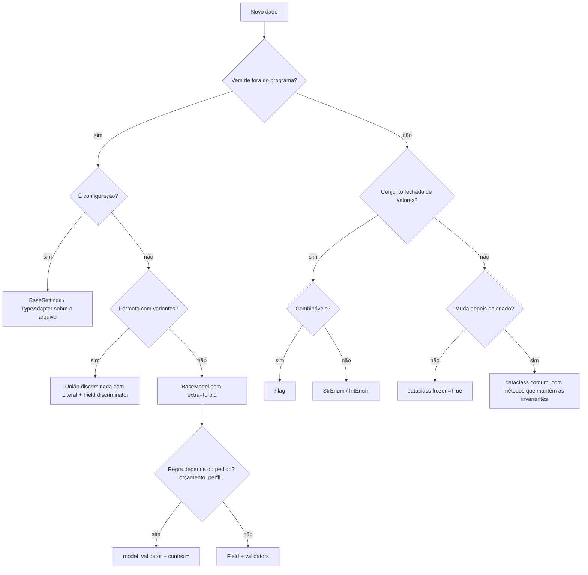

# Camadas de dados com Enum, Pydantic e dataclass

Guia de projeto, implementação e revisão. Base: estudo `dante-souza/studies`, pasta `data-and-classes/` (módulos
`enum/`, `dataclass/`, `pydantic/`, `dataclass_factory/` e a trilha `AI_use_cases/`, todos com notebooks executados).

**Marcas de confiança nas pegadinhas:** **(V)** verificada no estudo, com código executado; **(R)** observada em resposta
real de LLM; sem marca = comportamento conhecido da biblioteca, não testado no estudo.

**Versões testadas:** Python 3.13 (sintaxe compatível com 3.11), Pydantic 2.13.5 (cruzado com 2.14.3), pydantic-settings
2.16, openai 3.49, pydantic-ai 2.68, rich 15, SQLAlchemy 2.1, PyYAML 6.0.

## Índice

1. Princípios
2. Árvore de decisão
3. Referência rápida das três ferramentas
4. Fluxo de trabalho
5. Casos de uso (16)
6. Catálogo de pegadinhas
7. Anti-padrões
8. Estratégia de testes
9. Checklist de revisão
10. Estilo de saída e entrega

---

## 1. Princípios

1. **Quem cria o dado escolhe a ferramenta.** De fora (API, arquivo, `.env`, usuário, banco, LLM) → Pydantic. Do próprio
   código (estado, resultados, eventos internos) → dataclass. Conjunto fechado de valores → Enum.
2. **Valide uma vez, na borda.** Dentro do núcleo, o dado já é confiável; revalidar a cada passo é custo sem ganho.
3. **Vocabulário fechado é Enum.** O **valor** do membro é contrato externo (JSON, prompt, banco, logs); o **nome** é detalhe interno.
4. **O que precisa ser garantido é código.** `description`, instrução de prompt e documentação são pedidos, não garantias.
5. **Erro de validação é feedback.** Mensagens claras voltam ao usuário, ao chamador ou ao LLM (retry).
6. **Erro silencioso é o pior erro.** Prefira falhar alto (`'250 grams' * 2` dá `'250 grams250 grams'` sem erro).
7. **Imutável por padrão no núcleo.** `frozen=True`, e cuidado: é raso.
8. **Toda tabela indexada por enum tem teste de cobertura.**

```
          BORDA (não confiável)                      NÚCLEO (confiável)
  ┌─────────────────────────────────┐     ┌─────────────────────────────────┐
  │ Pydantic                        │     │ dataclasses (frozen / slots)    │
  │  • BaseSettings (env, arquivos) │ ──► │  • entidades, value objects     │
  │  • DTOs de request / response   │     │  • estado, eventos internos     │
  │  • saída de LLM, args de tools  │ ◄── │  • resultados, contexto         │
  │  • linhas de CSV, payloads      │     │  • uso, custo, rastreio         │
  └─────────────────────────────────┘     └─────────────────────────────────┘
                   ▲                                      ▲
                   └───────── Enum (vocabulário) ────────────┘
                       status, tipos, rótulos, permissões (Flag)
```

## 2. Árvore de decisão



## 3. Referência rápida

### Enum

| Tipo | Quando | Observação |
|---|---|---|
| `StrEnum` | valores de texto que vão para JSON, prompt, banco | membro **é** `str`: compara com texto, aparece como texto em f-string |
| `IntEnum` | códigos numéricos legados | compara com `int` (pode mascarar erro de tipo) |
| `Enum` | identidade pura, sem igualdade com primitivo | `Enum("x") == "x"` é `False` |
| `Flag` | permissões e capacidades combináveis | `A \| B`, `in`; cuidado com `Flag(0)` |
| `Literal[...]` | vocabulário local de um único modelo | sem comportamento nem reuso; enum quando o vocabulário circula |

### Pydantic (v2)

| Recurso | Uso |
|---|---|
| `ConfigDict(extra="forbid")` | entrada não confiável: chave desconhecida é erro |
| `ConfigDict(frozen=True)` | modelo imutável e hashable (se os campos forem) |
| `ConfigDict(strict=True)` / `Strict()` | sem conversão (`"1"` não vira `1`) |
| `ConfigDict(validate_default=True)` | defaults também passam pela validação |
| `ConfigDict(from_attributes=True)` | ler objetos (ORM) por atributo |
| `ConfigDict(validate_by_name=True)` | aceitar o nome do campo além do alias |
| `Field(gt=, le=, pattern=, description=)` | restrições; `description` vai para o JSON Schema |
| `BeforeValidator` / `AfterValidator` | normalizar antes / regra depois do tipo |
| `model_validator(mode="after")` | regra entre campos; recebe `ValidationInfo` (contexto) |
| `PrivateAttr` | valor calculado guardado no objeto, fora do schema |
| `TypeAdapter(T)` | validar tipos que não são modelos (`list[Item]`, dataclass) |
| `BaseSettings` | configuração de env e `.env`, com `SecretStr` |
| `model_dump(mode="json")` | dict seguro para JSON (Decimal, date, enum como valor) |
| `model_json_schema()` | contrato para documentação e para prompt de LLM |

Ordem de execução: `BeforeValidator` (vários: ordem **reversa**) → tipo e restrições do `Field` → `AfterValidator` →
`model_validator(mode="after")`.

### dataclass

| Recurso | Uso |
|---|---|
| `frozen=True` | imutável e hashable; raso |
| `slots=True` | menos memória, atributos fixos; recria a classe |
| `kw_only=True` | construtor só por nome (evita troca de posição) |
| `field(default_factory=...)` | default mutável |
| `__post_init__` | **invariantes** do núcleo, não validação de entrada |
| `dataclasses.replace(obj, x=...)` | cópia alterada de objeto frozen |
| `asdict` | exporta recursivamente (copia tudo; caro em objetos grandes) |

## 4. Fluxo de trabalho

1. **Mapear as fronteiras:** listar cada dado e sua origem. Isso decide a ferramenta.
2. **Vocabulário:** enums antes dos modelos; decidir os **valores** com cuidado (serão gravados).
3. **Contrato de borda:** `extra="forbid"`, tipos precisos, restrições, mensagens claras.
4. **Regras:** as que dependem só do dado em validators; as que dependem do pedido em `model_validator` + `context=`.
5. **Núcleo:** converter para dataclasses; invariantes em `__post_init__`; contexto e config `frozen`.
6. **Tabelas e políticas:** dicts indexados por enum com teste de cobertura; `match` com `case _`.
7. **Testes:** cobertura de enums, matriz de política, ida e volta da serialização, uma pegadinha por teste.
8. **Entrega:** dizer o que foi testado e o que não foi; exemplo construído nunca é apresentado como saída real.

---

## 5. Casos de uso

Cada caso: **cenário**, **desenho**, **código**, **pegadinhas**, **possibilidades**. Os casos 5.1 a 5.9 seguem a trilha
`AI_use_cases` (assistente de lista de compras); 5.10 a 5.16 vêm do `dataclass_factory` e dos módulos de estudo.

### 5.1 Saída estruturada de LLM

**Cenário:** o modelo devolve texto; o programa precisa de dados com forma e tipos.
**Desenho:** contrato Pydantic → JSON Schema no prompt (ou saída nativa) → extrair o JSON → validar.

```python
class Ingrediente(BaseModel):
    model_config = ConfigDict(extra="forbid")
    nome: str
    quantidade: float = Field(gt=0, description="Número, sem unidade")
    unidade: Unidade

class ListaDeCompras(BaseModel):
    model_config = ConfigDict(extra="forbid")
    prato: str
    porcoes: int = Field(gt=0)
    ingredientes: list[Ingrediente]

def prompt_com_schema(instrucao: str, modelo: type[BaseModel]) -> str:
    return (f"{instrucao}\nResponda SOMENTE com um JSON válido que siga este JSON Schema:\n"
            f"{json.dumps(modelo.model_json_schema(), ensure_ascii=False)}")

def extrair_json(texto: str) -> str:
    inicio, fim = texto.find("{"), texto.rfind("}")
    if inicio == -1 or fim == -1:
        raise ValueError("nenhum objeto JSON na resposta")
    return texto[inicio:fim + 1]

lista = ListaDeCompras.model_validate_json(extrair_json(resposta))
```

| Jeito | Como | Funciona em |
|---|---|---|
| schema no prompt | `prompt_com_schema` + `model_validate_json` | qualquer endpoint compatível |
| saída nativa | `client.chat.completions.parse(response_format=Modelo)` → `.parsed` | endpoints que suportam (testado em endpoint compatível) |
| pydantic-ai | `Agent(OpenAIChatModel(nome, provider=OpenAIProvider(base_url=, api_key=)), output_type=Modelo)` | idem, menos código |

**Pegadinhas**
- Formato pedido só no prompt não é garantido; quantidade em texto multiplica em silêncio (`'250 grams' * 2`) **(V)**.
- Resposta vem com texto ou cerca ```` ```json ```` em volta **(R)**: `model_validate_json` dá `json_invalid`; extraia antes **(V)**.
- Quantidade não numérica, como `"to taste"` **(R)**: o contrato precisa decidir (ver possibilidades).
- O modelo pode devolver uma **lista solta** em vez do objeto **(R)**: `Input should be an object` **(V)**.
- `description` é pedido, não regra: `unidade: str` com description "g, kg..." aceita `"cups"` **(V)**.
- Saída nativa strict: o default some do schema e o campo opcional vira obrigatório-nullable (`to_strict_json_schema`) **(V)**.
- pydantic-ai no Jupyter: `run_sync` levanta `RuntimeError: This event loop is already running`; use `await agente.run(...)` **(V)**.
- `pydantic_function_tool`/saída nativa geram `strict: true`; endpoints compatíveis podem ignorar: valide localmente sempre.

**Possibilidades**
- Lista solta: `TypeAdapter(list[Ingrediente]).validate_json(...)` e, em `extrair_json`, considerar `[`.
- Quantidade opcional: `quantidade: float | None` + `a_gosto: bool`, ou união `float | Literal["a gosto"]`.
- `TestModel` do pydantic-ai para testar o encanamento sem rede.
- Gravar respostas reais em `respostas_gravadas/` e testá-las offline contra o contrato.

### 5.2 Vocabulário e guardrail de escopo

**Cenário:** campos com valores livres (`"cups"`) e pedidos fora do escopo.
**Desenho:** enums no contrato; o modelo declara o tipo do pedido; o código trata cada tipo.

```python
class TipoPedido(StrEnum):
    RECEITA = "receita"
    FORA_DO_ESCOPO = "fora_do_escopo"

class RespostaAssistente(BaseModel):
    model_config = ConfigDict(extra="forbid")
    tipo: TipoPedido
    lista: ListaDeCompras | None = None
    motivo: str | None = None

    @model_validator(mode="after")
    def tipo_combina_com_conteudo(self):
        if self.tipo is TipoPedido.RECEITA and self.lista is None:
            raise ValueError("tipo 'receita' exige 'lista'")
        if self.tipo is TipoPedido.FORA_DO_ESCOPO and (self.lista is not None or not self.motivo):
            raise ValueError("tipo 'fora_do_escopo' exige 'motivo' e não aceita 'lista'")
        return self

def tratar(r: RespostaAssistente) -> str:
    match r.tipo:
        case TipoPedido.RECEITA:
            return f"lista de {r.lista.prato}"
        case TipoPedido.FORA_DO_ESCOPO:
            return f"só ajudo com compras ({r.motivo})"
        case _:
            raise ValueError(f"tipo sem tratamento: {r.tipo!r}")
```

**Pegadinhas**
- Enum compara texto exato: `"G"` e `" g"` falham **(V)**. Normalize caixa e espaços com `BeforeValidator`; sinônimos (`"gramas"`) são decisão de negócio.
- `match` sem `case _` devolve `None` em silêncio quando o enum ganha membro **(V)**.
- Enum garante vocabulário, não bom senso: 3 kg de sal para 2 pessoas passa **(V)**.
- `StrEnum` com um dict no corpo levanta `TypeError`; `Enum` comum transforma o dict em membro em silêncio **(V)**.

**Possibilidades**
- Organizar saída pela ordem de declaração do enum (`for c in Categoria`), como seções do mercado.
- Metadados por membro (rótulo, cor, limite) em dict indexado pelo enum, com teste de cobertura.
- Enum aberto (`DESCONHECIDO`) quando derrubar o pedido inteiro é pior que mandar para uma rota segura (5.7).

### 5.3 Ferramentas (tool calling) com guardrail

**Cenário:** o modelo precisa de dados reais (preços, estoque); quem executa é o código.
**Desenho:** enum com a lista fechada de ferramentas; um modelo Pydantic por conjunto de argumentos; execução que confere
tudo e devolve erro como resultado.

```python
class Ferramenta(StrEnum):
    CONSULTAR_PRECO = "consultar_preco"
    VERIFICAR_DESPENSA = "verificar_despensa"

class ArgsIngrediente(BaseModel):
    model_config = ConfigDict(extra="forbid")
    nome: str

FERRAMENTAS = {Ferramenta.CONSULTAR_PRECO: (ArgsIngrediente, consultar_preco),
               Ferramenta.VERIFICAR_DESPENSA: (ArgsIngrediente, verificar_despensa)}
TOOLS = [openai.pydantic_function_tool(args, name=f.value, description=DESCRICOES[f])
         for f, (args, _) in FERRAMENTAS.items()]

def executar_ferramenta(nome: str, argumentos_json: str) -> str:
    try:
        ferramenta = Ferramenta(nome)
    except ValueError:
        return json.dumps({"erro": f"ferramenta desconhecida: {nome}"})
    modelo_args, funcao = FERRAMENTAS[ferramenta]
    try:
        args = modelo_args.model_validate_json(argumentos_json)
    except ValidationError as ex:
        return json.dumps({"erro": "argumentos inválidos", "detalhes": ex.errors(include_url=False)},
                          ensure_ascii=False, default=str)
    return json.dumps(funcao(**args.model_dump()), ensure_ascii=False)
```

O laço: `chamar_modelo` entra como parâmetro (API real ou roteiro); limite de rodadas numa dataclass `frozen`; cada
resultado volta como mensagem `role="tool"` com o `tool_call_id`.

**Pegadinhas**
- Sem `max_rodadas`, um modelo que pede ferramentas para sempre não termina **(V)**.
- Busca por nome exato: o modelo consultou `"tomate"`, a tabela tinha `"tomate italiano"` **(R)**.
- `float` para dinheiro acumula erro (`0.10 + 0.20 = 0.30000000000000004`) **(V)**.
- O resultado da ferramenta volta ao prompt: dado de fonte externa é entrada não confiável.
- `mensagem.model_dump(exclude_none=True)` ao reenviar a mensagem do assistente: endpoints compatíveis podem recusar campos `None`.

**Possibilidades**
- Chaves canônicas (`slug`) e tabela de sinônimos; ou ferramenta de busca que devolve candidatos.
- Ferramentas por rota (menor privilégio, 5.5) e por perfil (5.7).
- Argumentos como união discriminada quando uma ferramenta tem modos.

### 5.4 Regras de negócio e retry com feedback

**Cenário:** a resposta passa no contrato mas viola regras (limites por pessoa, duplicados).
**Desenho:** regras como funções que devolvem `list[str]`; o pedido é validado **antes** da chamada; na violação, a
resposta e os erros voltam ao modelo, até um limite.

```python
@dataclass
class ResultadoPedido:
    lista: ListaDeCompras
    tentativas: int
    erros_por_tentativa: list[list[str]] = field(default_factory=list)

def pedir_lista(prato, porcoes, chamar_modelo, max_tentativas=3) -> ResultadoPedido:
    validar_pedido(prato, porcoes)                      # erro determinístico não gasta chamada
    mensagens, historico = [...], []
    for tentativa in range(1, max_tentativas + 1):
        texto = chamar_modelo(mensagens)
        lista, erros = erros_da_resposta(texto)          # contrato + regras
        historico.append(erros)
        if not erros:
            return ResultadoPedido(lista, tentativa, historico)   # saída 1: sucesso, no meio do laço
        mensagens += [{"role": "assistant", "content": texto},
                      {"role": "user", "content": "Corrija:\n- " + "\n- ".join(erros)}]
    raise RuntimeError(f"sem resposta válida em {max_tentativas} tentativas")  # saída 2: fracasso
```

**Pegadinhas**
- Regras fora do contrato: qualquer caminho que crie o modelo pula as regras **(V)**.
- Cada tentativa reenvia a conversa inteira: o tamanho enviado cresce a cada rodada **(V)**.
- Retry não conserta pedido ruim: valide a entrada antes **(V)**.
- `except ValidationError` antes de `except ValueError`: `ValidationError` é subclasse de `ValueError` **(V)**.

**Possibilidades**
- Levar as regras para dentro do contrato com contexto (5.6).
- Corte do histórico por orçamento de tokens (5.8) e um modelo mais barato para a correção.

### 5.5 Roteamento por intenção

**Cenário:** pedidos de tipos diferentes (receita, preço, substituição, fora do escopo).
**Desenho:** o modelo **classifica** (saída pequena), uma tabela **decide**; limiar de confiança; ferramentas por rota.

```python
class Classificacao(BaseModel):
    intencao: Intencao
    confianca: float = Field(ge=0, le=1)
    prato: str | None = None
    ingrediente: str | None = None

ROTAS: dict[Intencao, Callable[[Classificacao], str]] = {
    Intencao.RECEITA: responder_receita,
    Intencao.PRECO: responder_preco,
    Intencao.SUBSTITUICAO: responder_substituicao,
    Intencao.FORA_DO_ESCOPO: recusar,
}
assert not set(Intencao) - ROTAS.keys(), "intenção sem rota"
FERRAMENTAS_POR_ROTA: dict[Intencao, frozenset[Ferramenta]] = {...}
assert FERRAMENTAS_POR_ROTA.keys() == set(Intencao)

def rotear(c: Classificacao) -> str:
    if c.confianca < LIMIAR_CONFIANCA:
        return "revisão humana"
    return ROTAS[c.intencao](c)
```

**Pegadinhas**
- A confiança é autodeclarada, não calibrada: 0.90 em quase tudo, 1.00 em "me indica um filme" **(R)**; um erro com 0.95 passa pelo limiar **(V)**.
- Rota faltando sem teste de cobertura vira `KeyError` em produção **(V)**.
- Trocar o valor `"preco"` por `"preço"` quebra a leitura de tudo que foi gravado **(V)**.
- Valor inventado (`"receita_doce"`) derruba a classificação inteira **(V)** → enum aberto (5.7).
- Enviar só algumas ferramentas não impede o modelo de pedir outra: confira na execução.

**Possibilidades**
- Conjunto de avaliação (pedido → intenção esperada) e taxa de acerto por intenção.
- Fila de revisão humana para baixa confiança ou `DESCONHECIDO`.

### 5.6 Contrato com contexto

**Cenário:** a mesma resposta é válida para um pedido e inválida para outro (orçamento, despensa, preços do dia).
**Desenho:** contexto `frozen` passado em `context=`; `model_validator` lê e falha sem contexto; valor calculado em `PrivateAttr`.

```python
@dataclass(frozen=True)
class ContextoPedido:
    orcamento: Decimal
    precos: Mapping[str, tuple[Decimal, Unidade]]
    despensa: Mapping[str, tuple[Decimal, Unidade]] = field(default_factory=dict)

    def __post_init__(self):
        for nome in ("precos", "despensa"):
            object.__setattr__(self, nome, MappingProxyType(dict(getattr(self, nome))))

class ListaComContexto(ListaDeCompras):
    _custo: Decimal | None = PrivateAttr(default=None)

    @model_validator(mode="after")
    def regras_com_contexto(self, info: ValidationInfo):
        ctx = info.context
        if not isinstance(ctx, ContextoPedido):
            raise ValueError("contexto obrigatório: valide com context=ContextoPedido(...)")
        total = ...                                   # converte unidades, desconta despensa, Decimal
        if total > ctx.orcamento:
            raise ValueError(f"custo R$ {total} passa do orçamento de R$ {ctx.orcamento}")
        self._custo = total
        return self

lista = ListaComContexto.model_validate_json(texto, context=ctx)
```

**Pegadinhas**
- O JSON Schema de `ListaComContexto` é idêntico ao de `ListaDeCompras`: o modelo não vê as regras; diga-as no prompt **(V)**.
- O construtor não recebe contexto (sempre falha); `model_copy(update=...)` não valida e carrega o custo velho **(V)**.
- `frozen=True` não congela o dict interno; `MappingProxyType` sim **(V)**.
- `Decimal(0.1)` carrega o erro do float; use `Decimal(str(x))` **(V)**.

**Possibilidades**
- O mesmo contrato com contextos diferentes nos testes (orçamento folgado e apertado).
- Contexto com relógio injetado (datas de validade) e perfil do usuário.

### 5.7 Permissões e políticas

**Cenário:** quem pode o quê; ações irreversíveis pedem confirmação humana.
**Desenho:** `Flag` de capacidades por perfil; tabela ferramenta → capacidade; decisão em enum; negar por padrão.

```python
class Capacidade(Flag):
    LER_PRECOS = auto()
    LER_DESPENSA = auto()
    FINALIZAR_PEDIDO = auto()

class Decisao(StrEnum):
    PERMITIR = "permitir"; NEGAR = "negar"; CONFIRMAR = "confirmar_com_humano"

def decidir(perfil: Perfil, nome: str) -> tuple[Decisao, str]:
    try:
        ferramenta = Ferramenta(nome)
    except ValueError:
        return Decisao.NEGAR, f"ferramenta desconhecida: {nome}"
    exigida = CAPACIDADE_EXIGIDA.get(ferramenta)
    if exigida is None:                                  # nunca .get(ferramenta, Capacidade(0))
        return Decisao.NEGAR, "sem capacidade mapeada"
    if perfil not in PERMISSOES or exigida not in PERMISSOES[perfil]:
        return Decisao.NEGAR, f"perfil {perfil} não tem {exigida.name}"
    if exigida & EXIGE_CONFIRMACAO:
        return Decisao.CONFIRMAR, "ação irreversível"
    return Decisao.PERMITIR, "ok"
```

Enum aberto que registra o desconhecido (independe de versão):

```python
def aceitar_desconhecido(v):
    if isinstance(v, str) and v not in {m.value for m in Intencao}:
        DESCONHECIDOS.append(v)
        return Intencao.DESCONHECIDO
    return v

intencao: Annotated[Intencao, BeforeValidator(aceitar_desconhecido)]
```

**Pegadinhas**
- `Flag(0) in X` é sempre `True`: um default "inofensivo" vira permissão total **(V)**.
- Pydantic 2.13.5: `model_validate_json` chama `Enum._missing_` com `None`; com dict chega o valor; 2.14.3 corrigiu **(V)**.
- `assert_never` só protege de verdade com mypy/pyright; em tempo de execução é um `AssertionError` **(V)**.
- Política no prompt não é política: o perfil vem da sessão, nunca do texto do usuário ou do modelo **(V)**.

**Possibilidades**
- Matriz perfil × ferramenta como teste (é ela que vale testar).
- Hierarquia de perfis por composição de `Flag`; log de auditoria de cada decisão.

### 5.8 Runtime: estado, custo, tempo e histórico

**Cenário:** quantas chamadas, tokens, custo, tempo; conversa que cresce sem limite.
**Desenho:** dataclasses: config `frozen`, `Uso` (tokens), `Span`/`Rastreio` (`perf_counter`), `Historico` que envia
turnos inteiros dentro de um orçamento.

```python
@dataclass(frozen=True)
class ConfigRuntime:
    modelo: str = "gpt-4o-mini"
    max_rodadas: int = 5
    orcamento_tokens_envio: int = 4000
    preco_entrada_por_milhao: Decimal = Decimal("0.15")   # ilustrativo: use a tabela do provedor

@dataclass
class Historico:
    sistema: dict
    mensagens: list[dict] = field(default_factory=list)
    def turnos(self) -> list[list[dict]]: ...          # um turno começa em cada mensagem "user"
    def para_envio(self, orcamento: int) -> list[dict]: ...   # sistema + turnos recentes que cabem
```

**Pegadinhas**
- Cortar o histórico por número de mensagens pode começar num `tool` órfão; a API recusa **(V)**.
- Lista como default de dataclass é bloqueada na criação da classe **(V)**.
- `Decimal * float` levanta `TypeError` **(V)**.
- Dataclass não valida: `ConfigRuntime(max_rodadas="cinco")` passa e quebra só no `range`, longe da causa **(V)**.
- Tokens estimados (caracteres/4) servem para cortar antes de enviar; custo usa `resposta.usage` real.
- Duração com `perf_counter` (monótono), não `time.time()`.

**Possibilidades**
- `slots=True` em objetos numerosos; `dataclasses.replace` para variantes de config.
- IDs de tool call únicos no cliente simulado, como na API real.

### 5.9 Pipeline completo

**Cenário:** juntar tudo: configuração do ambiente, entrada validada, classificação, rota, lista com contexto,
cache, log e testes.

```python
class Configuracoes(BaseSettings):
    model_config = SettingsConfigDict(env_prefix="COMPRAS_", env_file=find_dotenv(usecwd=True) or None,
                                      extra="ignore", validate_by_name=True)
    api_key: SecretStr = Field(validation_alias=AliasChoices("COMPRAS_API_KEY", "openai"))
    base_url: str = Field(default="https://api.openai.com/v1",
                          validation_alias=AliasChoices("COMPRAS_BASE_URL", "openai_base_url"))
    max_tentativas: int = Field(default=3, ge=1, le=5)

class Pedido(BaseModel):
    texto: str = Field(min_length=1, max_length=500)
    perfil: Perfil                       # da sessão
    porcoes: int = Field(default=2, ge=1, le=20)
    orcamento: Decimal | None = Field(default=None, gt=0)

def chave(pedido: Pedido) -> str:        # tudo que muda a resposta entra na chave
    normalizado = pedido.model_dump(mode="json") | {"texto": " ".join(pedido.texto.lower().split())}
    return hashlib.sha256(json.dumps(normalizado, sort_keys=True).encode()).hexdigest()[:16]
```

Eventos estruturados (`pedido`, `status`, `detalhe` já redigido) no console pelo logger e em JSONL; cliente simulado
com a mesma interface do `OpenAI(...)` para testes offline; trocar pelo cliente real é uma linha.

**Pegadinhas**
- Chave de cache só com o texto: um visitante recebe a resposta montada para um cliente **(V)**; cache sem TTL guarda preço velho.
- `str(SecretStr)` é `**********`; passar isso ao cliente dá erro de autenticação longe da causa **(V)**.
- `validation_alias` + `extra="ignore"`: `Configuracoes(api_key=...)` é ignorado em silêncio sem `validate_by_name=True` **(V)**.
- Redação por regex deixa passar formatos desconhecidos (`4111.1111...`, "ana arroba exemplo") **(V)**; o melhor é não registrar texto bruto.
- Testes com modelo simulado testam o encanamento, não a qualidade do modelo.

**Possibilidades**
- Avaliação com o cliente real medindo taxa de acerto, não passou/falhou.
- Idempotência com TTL ou invalidação por versão da tabela de preços.

### 5.10 Configuração por arquivo, em camadas

**Cenário:** `base.yaml` + `prod.yaml` + variáveis de ambiente, com segredos.
**Desenho:** carregar cada fonte, mesclar em camadas, validar **uma vez** com Pydantic; segredos só por ambiente.

| Formato | Tipos nativos | Cuidado |
|---|---|---|
| JSON | número, bool, null, lista, objeto | sem comentários |
| TOML | inclui datas e inteiros/floats distintos | `tomllib` só lê |
| YAML | tudo, implícito | YAML 1.1 (PyYAML): `no`/`off` viram `False`, `3.10` vira `3.1`; `"3.10"` com aspas fica texto **(V)**; use `safe_load` |
| INI | só texto | toda conversão é sua (ou do Pydantic) |
| `.env` | só texto | aspas e espaços variam entre bibliotecas |

```python
def mesclar(base: dict, extra: dict) -> dict:
    resultado = dict(base)
    for chave, valor in extra.items():
        if valor is None and isinstance(base.get(chave), dict):
            raise ValueError(f"'{chave}: null' apagaria a seção inteira")
        if isinstance(valor, dict) and isinstance(base.get(chave), dict):
            resultado[chave] = mesclar(base[chave], valor)
        else:
            resultado[chave] = valor
    return resultado

config = TypeAdapter(AppConfig).validate_python(mesclar(base, prod))
```

**Pegadinhas**
- `deep_merge` ingênuo: `secao: null` no arquivo de produção apaga a seção inteira **(V)**.
- Dataclass via `TypeAdapter` ignora chaves extras (erro de digitação some): `__pydantic_config__ = {"extra": "forbid"}` **(V)**, que propaga para dataclasses aninhadas; `TypeAdapter(config=...)` é recusado para dataclass **(V)**.
- `strict=True` com dataclass aninhada exige instância exata (BaseModel aceita dict) **(V)**.
- Defaults não são validados: um default enum escrito como `2` continua `int` **(V)**.

**Possibilidades**
- Precedência explícita: argumentos > ambiente > `.env` > arquivo > default (`BaseSettings` já segue boa parte).
- Políticas e presets em arquivo (`ConfigDict` vindo de YAML, validado antes de aplicar).

### 5.11 Fábricas a partir de configuração

**Cenário:** a config diz qual implementação usar (fontes, exportadores, estratégias).
**Desenho:** união discriminada por `Literal` para os parâmetros; registro `dict[Enum, type]` para a implementação.

```python
class FonteCSV(BaseModel):
    tipo: Literal["csv"]
    caminho: Path

class FonteAPI(BaseModel):
    tipo: Literal["api"]
    url: HttpUrl

Fonte = Annotated[FonteCSV | FonteAPI, Field(discriminator="tipo")]

class Pipeline(BaseModel):
    fontes: list[Fonte]

LEITORES: dict[str, type[Leitor]] = {"csv": LeitorCSV, "api": LeitorAPI}
assert set(LEITORES) == {"csv", "api"}
```

**Pegadinhas**
- União sem discriminador tenta os membros e produz erros confusos; com discriminador, o erro aponta o tipo certo.
- Registro por `__init_subclass__(..., chave=...)` + `@dataclass(slots=True)`: a classe é recriada e o hook roda de novo sem os kwargs (`TypeError`) **(V)**; use `ClassVar` para a chave.
- `frozen=True` em modelo raiz com submodelos não-frozen: o raiz não é hashable **(V)**.

**Possibilidades**
- Abstract factory: um enum de "perfil de ambiente" escolhe um conjunto coerente de implementações.
- Plugins: o registro aceita novas chaves, com teste de que o enum e o registro andam juntos.

### 5.12 Modelos gerados de especificação

**Cenário:** um meta-modelo (YAML) descreve entidades; gerar enums, modelos e até código-fonte.
**Desenho:** validar a especificação com Pydantic → `Enum("Nome", valores)` → `create_model` / `make_dataclass` →
opcionalmente gerar `.py` e checar com mypy.

```python
Modelo = create_model(
    spec.nome,
    __config__=ConfigDict(extra="forbid"),
    **{c.nome: (tipo_de(c), Field(**c.restricoes)) for c in spec.campos},
)
```

Separe **normalização** (`BeforeValidator`, roda antes das restrições) de **validação** (`AfterValidator`).

**Pegadinhas**
- `AfterValidator(upper)` depois de `pattern` em maiúsculas: o padrão vê o texto ainda minúsculo e falha **(V)**; normalize com `BeforeValidator`.
- `StringConstraints(pattern=...)` roda antes de `to_lower` **(V)**.
- Default de enum vindo da spec não é convertido: converta ao montar o modelo **(V)**.
- `Field` antes de `BeforeValidator` mantém a mensagem específica do campo **(V)**.
- Código gerado: docstring vinda da spec pode injetar código (use `repr`) **(V)**; `repr(date)` não é literal Python válido sem import **(V)**.
- Colisões: aliases repetidos, nomes que sombreiam atributos do `BaseModel`, valores diferentes que viram o mesmo nome de membro **(V)**.
- `uuid4` usado como **tipo** (é função): o tipo é `UUID`, com `default_factory=uuid4` **(V)**.

**Possibilidades**
- `make_dataclass` para o núcleo e `create_model` para a borda, a partir da mesma spec.
- Gerar código para versionar e revisar em diff, em vez de criar classes só em tempo de execução.

### 5.13 DTOs de API

**Cenário:** API HTTP (FastAPI) com criação, atualização parcial e leitura.
**Desenho:** um modelo por direção; nunca expor o modelo interno.

```python
class ProdutoCriar(BaseModel):
    model_config = ConfigDict(extra="forbid")
    nome: str = Field(min_length=1)
    preco: Decimal = Field(gt=0)
    categoria: Categoria

class ProdutoAtualizar(BaseModel):
    model_config = ConfigDict(extra="forbid")
    nome: str | None = None
    preco: Decimal | None = Field(default=None, gt=0)

class ProdutoLer(BaseModel):
    model_config = ConfigDict(from_attributes=True)
    id: UUID
    nome: str
    preco: Decimal
    categoria: Categoria

mudancas = atualizacao.model_dump(exclude_unset=True)   # só o que o cliente mandou
```

**Pegadinhas**
- `exclude` usa nomes de campo; passar o alias é ignorado em silêncio **(V)**.
- Ordem dos erros pode mudar entre versões (no 2.14, o erro de campo extra veio por último) **(V)**: teste o conteúdo, não a ordem.
- `model_validate(instancia)` devolve a mesma instância, sem copiar **(V)**.
- `exclude_unset` x `exclude_none`: `None` enviado de propósito (apagar valor) é diferente de campo ausente.

**Possibilidades**
- `response_model` separado do modelo de banco; `computed_field` para valores derivados na resposta.
- Schema OpenAPI gerado dos mesmos modelos que validam.

### 5.14 Persistência e enums no banco

**Cenário:** gravar e ler enums e modelos via ORM.
**Desenho:** gravar o **valor** do enum (contrato estável), ler com `from_attributes=True`.

```python
status: Mapped[Status] = mapped_column(
    SAEnum(Status, native_enum=False, values_callable=lambda e: [m.value for m in e]))
```

**Pegadinhas**
- Por padrão, o `Enum` do SQLAlchemy grava o **nome** do membro (`'PAGO'`), não o valor (`'pago'`) **(V)**: renomear o membro quebra dados antigos; `values_callable` grava o valor **(V)**.
- `use_enum_values=True` no Pydantic guarda o **valor** (`str`), não o membro **(V)**: `is Status.PAGO`, `isinstance(x, Status)` e `.name` deixam de funcionar; com `StrEnum`, o `==` continua `True` e esconde a diferença **(V)**.
- Enum que ganha membro precisa de migração quando o banco usa tipo enum nativo.

**Possibilidades**
- `CHECK` constraint gerado da lista de valores do enum.
- Tabela de referência quando o vocabulário muda com frequência (enum só para o que é estável).

### 5.15 Importação de dados tabulares (CSV)

**Cenário:** planilha com números no formato brasileiro, datas, categorias.
**Desenho:** um modelo por linha; validar linha a linha para coletar erros com número da linha; `TypeAdapter` criado uma vez.

```python
def parse_brl(v):
    if isinstance(v, str):
        texto = v.strip()
        if not re.fullmatch(r"-?\d{1,3}(\.\d{3})*(,\d+)?|-?\d+(,\d+)?", texto):
            raise ValueError(f"número em formato inválido: {v!r}")
        return Decimal(texto.replace(".", "").replace(",", "."))
    return v

ValorBRL = Annotated[Decimal, BeforeValidator(parse_brl)]

class Venda(BaseModel):
    data: date
    produto: str
    valor: ValorBRL

validos, erros = [], []
for numero, linha in enumerate(csv.DictReader(arquivo), start=2):
    try:
        validos.append(Venda.model_validate(linha))
    except ValidationError as ex:
        erros.append((numero, ex.errors(include_url=False)))
```

`parse_brl` testado: aceita `1.234,56` → `1234.56`, `1234,5`, `-2,50`; rejeita `1.5`, `12.34` e `1,234.56` **(V)**.

**Pegadinhas**
- `"1.5"` lido como `15` por um parser que só remove pontos **(V)**: exija o formato com regex estrita.
- Datas `dd/mm/aaaa` não são ISO: converta com `strptime` num `BeforeValidator`, com mensagem clara **(V)**.
- No 2.14, o JSON Schema de `Decimal` perdeu o `pattern` **(V)**: não dependa dele.

**Possibilidades**
- Relatório de erros por linha (tabela) antes de importar; modo "tudo ou nada" x "importa os válidos".
- `TypeAdapter(list[Venda])` quando o arquivo precisa ser válido inteiro.

### 5.16 Eventos e logs estruturados

**Cenário:** trilha de auditoria, eventos entre serviços, logs legíveis por máquina.
**Desenho:** evento como modelo (ou dict validado) com `tipo` e `versao`; JSONL sem cor no arquivo; cor só na leitura.

```python
class EventoPedidoV1(BaseModel):
    tipo: Literal["pedido"]
    versao: Literal[1]
    pedido: str
    status: Status

Evento = Annotated[EventoPedidoV1 | EventoPagamentoV1, Field(discriminator="tipo")]

with JsonlWriter("eventos.jsonl") as escritor:        # logger_general.py
    escritor.write(evento.model_dump(mode="json"))
view_file("eventos.jsonl", semantic_rules={"status": {"falhou": "bad"}})   # prettifier.py
```

**Pegadinhas**
- Códigos de cor gravados em arquivo estragam a leitura por máquina: grave limpo, colora ao ler **(V)**.
- Timestamp nos logs muda toda execução: notebooks e HTML gerados ficam com diff ruidoso **(V)**.
- Evento sem `versao` torna a evolução do formato um problema de adivinhação.

**Possibilidades**
- União discriminada por `tipo` e, dentro dela, por `versao`, com função de upgrade V1 → V2.
- Redação na hora de registrar (e-mail, cartão) e chave de correlação (hash do pedido).

---

## 6. Catálogo de pegadinhas

Resumo para revisão rápida (detalhes nos casos acima).

| Área | Pegadinha | Remédio |
|---|---|---|
| Pydantic | `description` não é regra **(V)** | enum, restrição, validator |
| Pydantic | validators não aparecem no JSON Schema **(V)** | regra também no prompt/documentação |
| Pydantic | strict nativo: opcional vira obrigatório-nullable **(V)** | conte com `null` explícito |
| Pydantic | `model_copy(update=)` não valida **(V)** | revalidar |
| Pydantic | defaults não validados **(V)** | `validate_default=True` ou converter o default |
| Pydantic | vários `BeforeValidator`: ordem reversa **(V)** | um validator composto, ou ordem consciente |
| Pydantic | restrições antes do `AfterValidator` **(V)** | normalizar com `BeforeValidator` |
| Pydantic | `info.data` sem o campo que falhou (KeyError) **(V)** | `info.data.get(...)` |
| Pydantic | `exclude` ignora alias em silêncio **(V)** | usar nomes de campo |
| Pydantic | `model_validate(instância)` devolve a mesma **(V)** | `model_copy(deep=True)` se precisar cópia |
| Pydantic | `str(SecretStr)` é a máscara **(V)** | `get_secret_value()` só no uso |
| Pydantic | `validation_alias` + `extra="ignore"` engole o nome **(V)** | `validate_by_name=True` |
| Pydantic | 2.13.5: `_missing_` recebe `None` no JSON **(V)** | `BeforeValidator` para enum aberto |
| Pydantic | `use_enum_values` guarda `str`; `==` ainda funciona com StrEnum **(V)** | evitar, ou não usar `is`/`isinstance` |
| Pydantic | ordem de erros muda entre versões **(V)** | testar conteúdo |
| Pydantic + dataclass | `TypeAdapter` ignora extras **(V)** | `__pydantic_config__ = {"extra": "forbid"}` |
| dataclass | não valida **(V)** | Pydantic na borda |
| dataclass | default mutável **(V)** | `default_factory` |
| dataclass | frozen raso **(V)** | `MappingProxyType`, tuplas |
| dataclass | `slots=True` + `__init_subclass__` kwargs **(V)** | `ClassVar` |
| Enum | comparação exata **(V)** | normalizar na borda |
| Enum | `match` sem `case _` **(V)** | `case _: raise` ou `assert_never` |
| Enum | tabela sem cobertura **(V)** | `assert not set(E) - T.keys()` |
| Enum | renomear valor **(V)** | valor é contrato; renomeie só o nome |
| Enum | `Flag(0) in X` **(V)** | `is None` explícito |
| Enum + ORM | SQLAlchemy grava o nome por padrão **(V)** | `values_callable` |
| YAML | `no`/`off` → `False`, `3.10` → `3.1` **(V)** | aspas, `safe_load` |
| Números | float para dinheiro **(V)** | `Decimal(str(x))` |
| Números | `"1.5"` → `15` em parser BR **(V)** | regex estrita |
| LLM | JSON com cerca/texto **(R)** | `extrair_json` |
| LLM | quantidade não numérica **(R)** | decidir no contrato |
| LLM | confiança não calibrada **(R)** | avaliação com gabarito |
| LLM | nome não bate com a chave **(R)** | chaves canônicas, sinônimos |
| LLM | corte quebra pares de tool **(V)** | cortar por turno |
| Python | `assert` some com `-O` **(V)** | `if ...: raise` para regras |
| Python | variável do `except ... as ex` é apagada ao sair do bloco **(V)** | copiar o que precisa dentro do bloco |
| Python 3.11 | barra invertida dentro da expressão de f-string **(V)** | variável auxiliar |
| Notebook | duas classes com o mesmo nome confundem `pickle` **(V)** | nomes distintos por célula |

## 7. Anti-padrões

- Um único modelo para entrada, banco e resposta.
- `dict` solto atravessando camadas ("saco de dados").
- Validar no meio do núcleo, de novo e de novo.
- Regra só no prompt, só no `description` ou só num comentário.
- `Any` e `extra="allow"` na borda sem motivo registrado.
- `except Exception: pass` em parsing.
- Enum cujo valor é texto de exibição (muda com a interface; o valor deveria ser estável).
- `__post_init__` fazendo papel de validação de entrada externa.

## 8. Estratégia de testes

- **Cobertura de enums:** toda tabela indexada por enum cobre todos os membros.
- **Matriz de política:** perfil × ação → decisão esperada.
- **Ida e volta:** `Modelo.model_validate(obj.model_dump(mode="json")) == obj`.
- **Uma pegadinha por teste:** cada item relevante do catálogo vira um teste que falharia sem o remédio.
- **Mensagens, não ordem:** compare conjuntos de erros (`{(e["loc"], e["type"]) for e in ex.errors()}`).
- **LLM offline:** cliente simulado com a interface do SDK (`.chat.completions.create` devolvendo os tipos do SDK) e roteiros que erram de propósito.
- **LLM real:** conjunto de avaliação com gabarito; medir taxa de acerto; gravar respostas reais para regressão.
- **Versões:** rodar a suíte em duas versões do Pydantic quando o comportamento importa.

## 9. Checklist de revisão

- [ ] Cada dado tem origem clara e a ferramenta certa (borda x núcleo).
- [ ] Entradas externas com `extra="forbid"` (ou motivo registrado para não).
- [ ] Vocabulários fechados são enums; valores tratados como contrato externo.
- [ ] Normalização em `BeforeValidator`; regras em `AfterValidator`/`model_validator`.
- [ ] Regras dependentes do pedido usam `context=` e falham sem contexto.
- [ ] Dinheiro em `Decimal`, construído de texto.
- [ ] Núcleo em dataclasses; frozen onde não muda; coleções internas protegidas.
- [ ] Tabelas por enum com teste de cobertura; `match` com `case _`.
- [ ] Permissões negam por padrão; perfil vem da sessão.
- [ ] Segredos em `SecretStr`; nunca em logs, `repr` ou JSON.
- [ ] Erros de validação viram mensagens úteis (para usuário ou LLM).
- [ ] Logs e JSONL sem dados sensíveis e sem códigos de cor.
- [ ] Testes cobrem as pegadinhas relevantes; o que não foi testado está dito.

## 10. Estilo de saída e entrega

- Prints como f-string, um valor por linha, no formato `expressão: valor`.
- Saídas visíveis, coloridas e bem indentadas. Quando o projeto tiver `prettifier.py` (arquivo único, depende de `rich`):
  `show(...)` no lugar de `print` (JSON longo sai indentado), `show_table` para listas, `show_panel` para prompts,
  `view_file` para ler JSONL e logs com cor.
- Eventos de execução (tentativas, negações, etapas) num logger (`logger_general.py`, só biblioteca padrão), não em print.
- Ao entregar: o que foi testado e o que não foi, com versões; exemplo construído sempre rotulado como construído.
