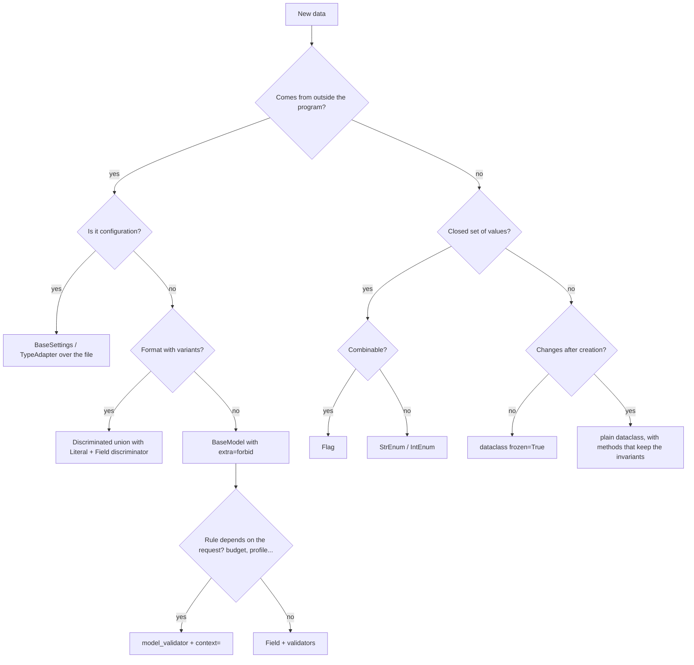

# Data layers with Enum, Pydantic and dataclass

Guide for design, implementation and review. Source: the study repository `dante-souza/studies`, folder
`data-and-classes/` (modules `enum/`, `dataclass/`, `pydantic/`, `dataclass_factory/` and the `AI_use_cases/` track, all
with executed notebooks). The study is written in Portuguese; this skill translates names, messages and comments to English.
A Portuguese version of the same skill lives in `skills/camadas-de-dados-python/`.

**Confidence marks on pitfalls:** **(V)** verified in the study, with executed code; **(R)** observed in a real LLM
response; no mark = known library behavior, not tested in the study.

**Versions tested:** Python 3.13 (syntax compatible with 3.11), Pydantic 2.13.5 (cross-checked with 2.14.3),
pydantic-settings 2.16, openai 3.49, pydantic-ai 2.68, rich 15, SQLAlchemy 2.1, PyYAML 6.0.

## How to use this skill

1. Read the **principles**, the **decision tree** and the **workflow** below: they decide the tool for each piece of data.
2. Open the **use case** closest to the task (table below): each one has design, code, pitfalls and possibilities.
3. Before delivering, go through the [pitfall catalog](pitfalls.md) and the [review checklist](testing_and_review.md).

| File | Read when |
|---|---|
| [`reference/tools.md`](reference/tools.md) | you need to recall Enum, Pydantic or dataclass features, or the validator order |
| [`cases/`](cases/) | you are designing or implementing a scenario (table below) |
| [`pitfalls.md`](pitfalls.md) | you are reviewing code or explaining strange behavior |
| [`testing_and_review.md`](testing_and_review.md) | you are writing tests or reviewing before delivery (anti-patterns, strategy, checklist) |

### Use cases

| # | Case | Scenario |
|---|---|---|
| 01 | [LLM structured output](cases/01_llm_structured_output.md) | the model returns text; the program needs data with shape and types. |
| 02 | [Vocabulary and scope guardrail](cases/02_vocabulary_and_scope_guardrail.md) | fields with free values (`"cups"`) and out-of-scope requests. |
| 03 | [Tool calling with a guardrail](cases/03_tool_calling_with_guardrail.md) | the model needs real data (prices, stock); the code is what executes. |
| 04 | [Business rules and retry with feedback](cases/04_business_rules_and_retry.md) | the response passes the contract but breaks rules (per-person limits, duplicates). |
| 05 | [Intent routing](cases/05_intent_routing.md) | requests of different kinds (recipe, price, substitution, out of scope). |
| 06 | [Contract with context](cases/06_contract_with_context.md) | the same response is valid for one request and invalid for another (budget, pantry, today's prices). |
| 07 | [Permissions and policies](cases/07_permissions_and_policies.md) | who may do what; irreversible actions require human confirmation. |
| 08 | [Runtime: state, cost, time and history](cases/08_runtime_state_cost_time_history.md) | how many calls, tokens, cost, time; a conversation that grows without limit. |
| 09 | [Full pipeline](cases/09_full_pipeline.md) | everything together: environment settings, validated input, classification, route, list with context, cache, log and tests. |
| 10 | [Layered file configuration](cases/10_layered_file_configuration.md) | `base.yaml` + `prod.yaml` + environment variables, with secrets. |
| 11 | [Factories from configuration](cases/11_factories_from_configuration.md) | the config says which implementation to use (sources, exporters, strategies). |
| 12 | [Models generated from a spec](cases/12_models_generated_from_spec.md) | a meta-model (YAML) describes entities; generate enums, models and even source code. |
| 13 | [API DTOs](cases/13_api_dtos.md) | HTTP API (FastAPI) with create, partial update and read. |
| 14 | [Persistence and enums in the database](cases/14_persistence_and_enums_in_the_db.md) | writing and reading enums and models through an ORM. |
| 15 | [Tabular data import (CSV)](cases/15_tabular_data_import_csv.md) | a spreadsheet with Brazilian-format numbers, dates, categories. |
| 16 | [Events and structured logs](cases/16_events_and_structured_logs.md) | audit trail, events between services, machine-readable logs. |

Cases 01 to 09 follow the `AI_use_cases` track (a shopping-list assistant); 10 to 16 come from `dataclass_factory` and
the study modules.

## Principles

1. **Whoever creates the data picks the tool.** From outside (API, file, `.env`, user, database, LLM) → Pydantic. From the
   program itself (state, results, internal events) → dataclass. A closed set of values → Enum.
2. **Validate once, at the border.** Inside the core the data is already trusted; revalidating at every step is cost without gain.
3. **A closed vocabulary is an Enum.** The member **value** is an external contract (JSON, prompt, database, logs); the **name** is an internal detail.
4. **What must be guaranteed is code.** `description`, prompt instructions and documentation are requests, not guarantees.
5. **A validation error is feedback.** Clear messages go back to the user, the caller or the LLM (retry).
6. **A silent error is the worst error.** Prefer failing loudly (`'250 grams' * 2` gives `'250 grams250 grams'` with no error).
7. **Immutable by default in the core.** `frozen=True`, and beware: it is shallow.
8. **Every table keyed by an enum has a coverage test.**
9. **Text only exists at the border, inside a type.** The application neither slices nor passes text along: a border type
   (`TypeAdapter(Annotated[Json[Model], BeforeValidator(extract_json)])`) takes the text and returns the validated object.

```
          BORDER (untrusted)                          CORE (trusted)
  ┌─────────────────────────────────┐     ┌─────────────────────────────────┐
  │ Pydantic                        │     │ dataclasses (frozen / slots)    │
  │  • BaseSettings (env, files)    │ ──► │  • entities, value objects      │
  │  • request / response DTOs      │     │  • state, internal events       │
  │  • LLM output, tool arguments   │ ◄── │  • results, context             │
  │  • CSV rows, payloads           │     │  • usage, cost, tracing         │
  └─────────────────────────────────┘     └─────────────────────────────────┘
                   ▲                                      ▲
                   └─────────── Enum (vocabulary) ────────┘
                       status, kinds, labels, permissions (Flag)
```

## Decision tree



## Workflow

1. **Map the borders:** list each piece of data and its origin. That decides the tool.
2. **Vocabulary:** enums before models; choose the **values** carefully (they will be stored).
3. **Border contract:** `extra="forbid"`, precise types, constraints, clear messages.
4. **Rules:** the ones that depend only on the data go in validators; the ones that depend on the request go in `model_validator` + `context=`.
5. **Core:** convert to dataclasses; invariants in `__post_init__`; context and config `frozen`.
6. **Tables and policies:** dicts keyed by enum with a coverage test; `match` with `case _`.
7. **Tests:** enum coverage, policy matrix, serialization round trip, one pitfall per test.
8. **Delivery:** say what was tested and what was not; a constructed example is never presented as real output.

## Output style and delivery

- Prints as f-strings, one value per line, in the form `expression: value`.
- Visible, colored and well-indented output. When the project has `prettifier.py` (single file, depends on `rich`):
  `show(...)` instead of `print` (long JSON comes out indented), `show_table` for lists, `show_panel` for prompts,
  `view_file` to read JSONL and logs in color.
- Runtime events (attempts, denials, steps) go to a logger (`logger_general.py`, standard library only), not to print.
- On delivery: what was tested and what was not, with versions; a constructed example is always labeled as constructed.
